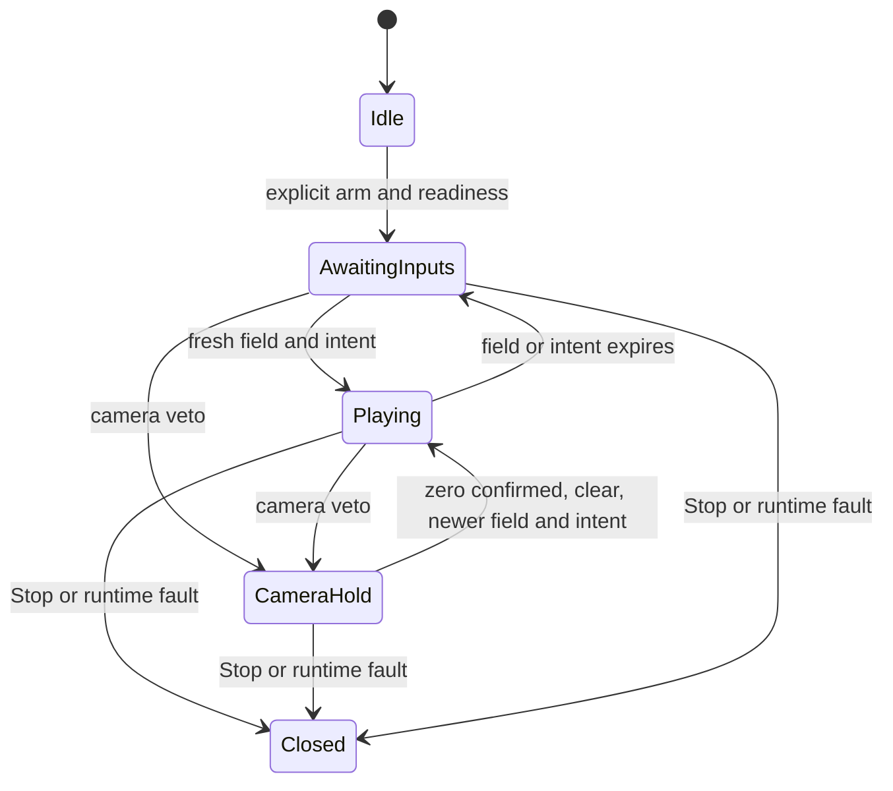

# Shooting behaviors

Recovered November 16, 2026 from `/home/pi/kick`, then corrected in this checkout.
[RECOVERY.json](RECOVERY.json) preserves the original hashes; the untouched
experiment and its archive remain available. [Reconciliation findings](../PI_RECONCILIATION.md)
separate source, simulated results and actual recorded robot outcomes.

The first candidate uses the existing walking policy to align behind a ball and
run through it. This follows the TA progression: establish measured contact with
locomotion before training a specialized shot. The learned header policy is
preserved as an **unaccepted experiment**: its recorded tilt-stop and late
activation handling remain unresolved. Nothing here starts with a source sync.

## Components

| File | Purpose |
| --- | --- |
| `run_through_kick.py` | Pure controller: align, charge, blind-zone coast, brake; manual, robot and field inputs |
| `run_through_kick_node.py` | ROS adapter with stock-controller/configuration checks and bounded fault handling |
| `ball_detector_node.py`, `ball_geometry.py`, `ball_color.py` | Onboard ball detection and capture-stamped, IMU-levelled robot-relative coordinates |
| `learned_kick.py`, `learned_kick_node.py`, `policies/` | Recovered target-conditioned learned candidate, held from activation |
| `launch/kick_trial.launch.py` | Shot adapter and private mux on top of an already running plain course stack |
| `tools/` | Recovered experimental helpers; the installer changes native source/config/policies and rebuilds, so it is not a baseline setup step |
| `body_command_guard.py` | Offline candidate that gates the mux's actual body-command output using capture-stamped camera evidence |
| [ROBOT_RUNBOOK.md](ROBOT_RUNBOOK.md) | Current supervised stock-shot baseline and evidence to collect |

## Stock shot

The ROS node defaults to **0.45 m/s charge** and **0.3 m/s alignment**. It polls
controller ownership and default-controller parameters asynchronously, admitting
only `neural_controller_default` with stock model SHA-256
`ecf3a4ab8ea392dccda64977faa29d813dadc0d6099ae3abff5f84cc57156712`.
Requests beyond the configured envelope (at most 0.49 m/s forward) are rejected.
The generic pure controller retains its experimental defaults; use the ROS node's
explicit baseline when evaluating hardware.

This prevents a concrete error in the recovered setup: dead reckoning integrated
requested speed even when the native walker clipped it. The fix rejects that
mismatch; it does not measure achieved speed. `speed_efficiency`, braking,
contact geometry and ball travel still need physical measurements.

Activation also requires a released e-stop gateway and expected `/cmd_vel`
publisher count. Missing/stale evidence, another active controller or a changed
model refuses a start. Loss of authority during a shot requests emergency stop
and aborts. Zero alone is not a stop for the learned target-conditioned slot.

The guard reads configured values, **not the native controller's loaded snapshot**.
The native controller caches model/configuration at initialization. Begin with a
verified fresh session and keep its configuration fixed. Sampled evidence and
publisher counts are not exclusive ownership; receiver-side command expiry is
still needed if the mux itself dies. Normal completion means commands finished,
not that the ball was hit.

## Interfaces and perception limits

- Output: `/kick_cmd_vel` (`Twist`), state: `/run_through_kick/state` (JSON).
- Services: `/activate_run_through_kick`, `/deactivate_run_through_kick` (`Trigger`).
- Ball: `/soccer/ball` (`PointStamped`), metres, x forward/y left in
  `base_link_yaw`; stamp is original image capture time on the robot ROS clock.
- Optional `/soccer/goal` uses the same point contract. In `input_mode=field`,
  both points and `/soccer/robot_pose` (`PoseStamped`) must use `frame_id=field`.
  Every field point needs a robot pose with its **exact capture stamp**, including
  a goal captured at a different time from the ball. A bounded 128-pose cache
  tolerates either callback arrival order; missing matches withhold the point.
  No overhead producer was recovered. It must supply synchronized snapshots;
  this adapter does not estimate poses between independently timed samples.

As of November 17, the stock shot consumer rejects wrong/empty frames, invalid,
future, expired, duplicate and reordered captures. Goals retain capture time;
arrival never extends their lifetime. Ball/goal captures are independently moved
to the current robot frame using the shot's command history before aim is
calculated. A capture preceding activation or retained history is unavailable.
Field orientation must be finite and unit length (up to 1% normalization error),
with a defined horizontal heading. Restart perception after a ROS clock reset;
an active camera shot aborts if its clock moves backwards.

`require_goal=true` waits for a goal even before its first packet. With the
default false, a fresh goal at activation or accepted during the shot latches goal
intent for that shot. Missing, stale or unsynchronized goal feedback pauses
ALIGN and aborts after `lost_timeout`; CHARGE aborts immediately. It does not
silently become a straight-through shot. An expired cache from a previous shot
does not latch the next activation. Goal-free shots and manual measurements
remain supported; the established blind-zone COAST behavior is unchanged.

Compensation assumes a stationary ball and goal and estimates motion from
commands scaled by `speed_efficiency`. It is not odometry and cannot correct
gait slip, a moving ball or timestamps from different clocks. The pure controller
also retains explicit `aim` for callers supplying an already-current direction;
the ROS adapter uses stamped goal points instead.

The onboard detector selects a valid preceding `base_link` IMU orientation for
an image. `imu_max_age=0.2` limits the IMU-to-image capture gap;
`max_image_age=0.5` limits image age at publication. It withholds coordinates for
missing/invalid/stale IMU, unsupported frames, or invalid/reordered capture times.
It never relabels unlevelled coordinates as `base_link_yaw` or refreshes a capture
stamp on receipt. The bounded 256-sample history covers these defaults at the
configured 260 Hz IMU rate. Restart the detector after a ROS clock-epoch reset;
ordering high-water marks intentionally do not automatically recover across it.

Color detection was tuned for a red/blue beach ball. Further contact trials await
the intended pink size-5 ball with flower patterns; the temporary mini basketball
is not the demo target. The existing detector has not been validated for that
ball. Camera mounting, ball radius and empirical range scale remain calibration
inputs, not established accuracy guarantees. Ryan's overhead geometry is the
primary planned source of shot targets.

## Offline checks

The optional guarded stock launch remaps the existing mux output to
`/fc/requested_cmd_vel`; the guard publishes admitted commands on `/cmd_vel`.
Four manifest roles select the guard interpreter, script, obstacle logic and
package initializer together. Stock manifests retain their original routing.
An optional hashed `guard_policy` file selects `all_obstacles` (the default for
old and new manifests) or explicit `arena_ball_contact`; runtime identity binds
that selection to the exact guard process arguments. Arena mode exempts only
class `"32"` from the expected lab HEF and canonical COCO label map. The producer
reports hashes from the selected model and loaded labels once at startup.
Missing or mismatched identity withholds arena motion; detection validation,
freshness, clear-frame hysteresis and other obstacle classes still apply.
The exception applies during approach as well as strike, since a strike-only
exception would prevent reaching the ball. It does not identify the intended
pink ball or protect against an obstacle misclassified solely as a sports ball.
Real ball/person coverage must pass before this candidate is used on the field.
Runtime selection verifies the guard process separately from native authority;
the movement client also checks the named ROS publishers. Guard loss cancels
requests without shutting down native standing or automatically restarting.
Competing publishers or lost native authority retain the emergency response.
These sources are not yet deployed; see the [assembly procedure](../../foundation/HARDWARE_CHECKLIST.md#guarded-walk-candidate).

## Continuous gameplay bridge

`fc_executor_bridge.py` runs one gameplay executor and ROS publisher per robot.
It publishes only its selected robot to `/kick_cmd_vel`; the existing mux,
camera guard and native controller remain downstream. A 20 ms steady-clock tick
checks command expiry independently of input traffic. The initial command
envelope is ±0.3 m/s forward/lateral and ±1 rad/s yaw. Two robot instances need
separate ROS domains with the existing absolute-topic stack.
Concurrent isolated ROS trials exercised both domains with opposite headings:
one robot's lease expiry, Stop and guard death did not interrupt the other's
distinct command stream or feed commands back into the stopped domain. This
used fake native feedback on one Linux host; separate robot commissioning and
cross-host clock conversion remain unverified.

The same real ROS chain also completed two separate mirrored one-robot
rehearsals: final `/cmd_vel` receipts drove the existing simulator through a
natural goal crossing, return home, sustained zero, simulated manual ball
replacement, one resume cue and another strike. Perception/native feedback and
contact physics were fixtures. These are integration results, not a shared-ball
match or physical shot evidence; the [overnight report](../../foundation/results/overnight-execution-20261117.json)
links the frozen commands, trajectories, reviews and source kit.

The CLI defaults to configuration validation with no ROS imports or processes:

```sh
python3 final_project/behaviors/fc_executor_bridge.py --robot-id pupper-1 --producer-id local-fixture
```

`--execute` requires an explicit six-value field configuration, opposite robot
attack signs, and `--runtime-receipt` selecting the guarded walk release and
executing source files. Geometry values are `length`, `width`, `goal_width`,
`robot_radius`, `ball_radius`, and `bumper_offset`, all in metres, under `field`;
`attack_signs` maps `pupper-1` and `pupper-2` to +1/−1. The old sandbox ball/goal
defaults are not silently used. This is a candidate, not a commissioned robot
procedure or an automatic startup service.

Operator stdin accepts JSON `command` values `arm`, `resume`, `start`, `status`,
`stop`, and `quit`. Arm needs a new `epoch` and fresh native, zero-command and
camera evidence. Start is the optional native gateway activation; it never homes
or arms gameplay. A bare `{"command":"resume"}` captures the completed goal
cycle when received and resolves the current fresh field frame when processed.
The cue expires after 0.2 seconds and cannot survive consumption or a new epoch;
it does not queue permission for a later goal. An explicit `frame_seq` remains
strict for programmatic callers. Status includes field/intent freshness and
read-only `resume.available`/`reason`; these are sampled observations and are
checked again on use. Stop wins during Start,
camera interruption and cleanup. Ordinary camera holds keep the session running;
a failed command path closes it while preserving healthy native standing.

Software Start requires the gateway's advertised
`software_stop_topic=/estop_controller/request_stop` capability. Hard Stop sends
both immediate native emergency and gateway cancellation, then waits boundedly
for a newer, same-instance Stop latch. Status separates interface availability,
Start capability and the gateway Stop receipt. Native damping can end policy
observations, so a gateway acknowledgement does not manufacture zero feedback
or prove physical stillness. Older gateways retain Options activation.



Playing includes offense/defense selection and approach, alignment, strike,
return-home and await-reset phases. A camera hold cancels the internal strike.
An interrupted finite shoot needs a new ID; a shoot offered while held is refused
and may be freshly issued after clearance. Continuous auto can replan with the
same live owner. A new arm after a prior hold still needs newer evidence.

ROS String `/fc/normalized_events` accepts only `frame` and `intent` events from
the configured `producer_id`. They use the executor's normalized contract and
`clock="linux-monotonic:<local Linux boot UUID>"`. Receipt replaces only event
`now`, never capture, issue or expiry. This first bridge supports a same-host
fixture; Ryan's actual camera clock still needs an adapter. These names identify
the intended source operationally and do not authenticate DDS traffic. Perception
cannot arm or send goal resume through this topic. Intents for the other robot
are refused; field snapshots can include both robots.

Use `--require-participants pupper-1 pupper-2` when both tracks are required for
motion. Each present row must carry its original `captured_at`, no later than
the enclosing frame's capture. Missing or stale required tracks hold every
action, including return-home, without renewing an intent. A newer envelope
cannot refresh an old row; changing pose at the same capture is rejected.
Goal/fallen flags may update with the enclosing frame while a pose repeats.
The default keeps the original synchronous solo fixture contract. This option
enforces track freshness; geometric opponent avoidance is still experimental.

`/fc/executor_bridge/status` exposes the selected robot, epoch, role/action,
decision, hold/fault reasons and applied-command receipt age at 5 Hz with a
latest-only best-effort publisher. Operator notifications use a bounded queue;
an unread stdout pipe cannot block the control tick. Applied feedback has no
source stamp, so receipt age is not exact controller latency. Status also names
required participants and their original capture ages and shared deadline.
Twist strips the original command lease. Each downstream watchdog expires its
own latest receipt; cached republication can extend the original source command.
A [device-free cascade](../../artifacts/pupper-fc/2026-11-17/command-survival/findings.json)
kept native nonzero input for 491 ms after source publication even though the
native 250 ms receipt watchdog worked. This is neither a measured worst-case
bound nor physical braking evidence. Legacy Twist does not enforce original
`expires_at` through the chain.

The explicit `--command-contract fc_deadline_v1` candidate uses
`/fc/body_command/request` → camera guard → `/fc/body_command/admitted` → native
controller, with no mux. It requires the matching selected runtime, rebuilt
native capability, source clock and unique topic graph. Bounded String envelopes
preserve original issue/deadline and source sequence; guard veto is irreversible
for that sequence. Disarmed zero messages complete readiness without arming or
renewing gameplay. Fresh native `command_authority` status must confirm the
current bridge instance; an old binding reports the need for native Stop/Start.
Once armed, missing or changed authority stops execution. The default legacy
mode remains available for existing movement qualification. Exact controller
expiry and actual guard/native failure traces are recorded in the
[integration evidence](../../foundation/results/overnight-execution-20261117.json);
they establish software-request expiry, not physical braking or Pi acceptance.

The viewer publishes `/fc/obstacle_detections` with original image capture
nanoseconds, a per-process instance ID, increasing sequence, explicit validity,
normalized boxes and fixed 700 × 572 / 220-degree projection. Detector confidence
is fixed at 0.4; viewer confidence, rotation and color edits affect display only.
Use `--swap-rb` at startup for detector color correction. A healthy empty result
means inference found nothing; it does not prove unobscured or obstacle-free space.
Frame submission now preserves a monotonic cadence instead of restarting the
interval after processing each frame. On 490 recorded camera timestamps, a
zero-inference scheduling replay admitted 299 frames before the fix and 490
after it. This removes an avoidable scheduling loss; actual Hailo throughput and
capture-to-guard age still require measurement. Stalls admit one latest frame
without a backlog or catch-up burst.

The guard requires three fresh clear frames. It reserves 50 ms for the supported
ROS/monotonic clock-offset window, leaving approximately 300 ms usable capture
age under the 350 ms deadline. Measure capture age **and frame spacing** before
guarded motion: inference latency plus frame period must fit, or the guard will
remain stopped. It stops every body axis during a hold. After vetoed motion,
upstream must send zero and then fresh motion after clearance; repeated old mux
commands cannot restart an interrupted action. A detector restart or clock fault
requires an explicit guard restart. These are candidate contracts, not physical
stopping-distance or detector-coverage acceptance.
Guard status includes its original `sampled_at_monotonic_ns`; both local clients
account for status transport delay, including the first received sample.

An ordinary camera hold interrupts a finite movement and invalidates its prepare
token. A confirmed zero and intact native/guard authority leave the resident
client available for a **new** prepare/run after clearance. The receipt labels
this `interrupted`, not completed. Pending or uncertain Start, explicit Stop during guarded cancellation,
unconfirmed cancellation, or a native fault still takes the emergency path.
The legacy idle Stop/quit behavior is unchanged: it can end an already stationary
Options-started client without deactivating the native controller.

From the repository root:

```sh
.venv-api/bin/python -m pytest -q final_project/behaviors final_project/pupper_fc/tests
```

`test_run_through_kick.py` uses a kinematic walker with separately delayed ball
and goal captures, plus analytic turn/translation geometry; node tests use fake
ROS to exercise admission, matching field snapshots and goal-loss handling.
`test_ball_perception.py` checks geometry, source-time/frame handling and image
publication without a camera. `ros_stock_guard_smoke.py` checks actual ROS service
and topic wiring with synthetic services in an isolated, network-disabled
container. It must not run on the robot's ROS graph. The dated receipt in
`foundation/results/shot-baseline-guards-20261116.json` records exact source and
container identities. These checks do not simulate motor dynamics or ball impact.

`tools/ros_fc_guard_smoke.py` exercises the real Start service and mux/guard ROS
wiring against a fake controller backend and velocity consumer. It requires the
isolated test container; never run it on a robot graph. Source/binary hashes,
container invocation, failed attempts and final results are linked in the
[overnight evidence](../../foundation/results/overnight-execution-20261117.json).
Guard death establishes publication silence only in this test; the fake consumer
does not implement or validate the native watchdog.
The separate `pupper_gait_deploy/test/test_guard_ros_watchdog.cpp` experiment
connects the real mux/guard to the production controller's DDS callback and update
using memory joints and a synthetic policy. Guard death produced zero on the
first update beyond the 250 ms receipt deadline (254.75 ms observed), while
normal gains remained enabled. Its frozen orchestration and full trace are in
the same evidence report; this is not physical braking or a hard scheduling bound.
