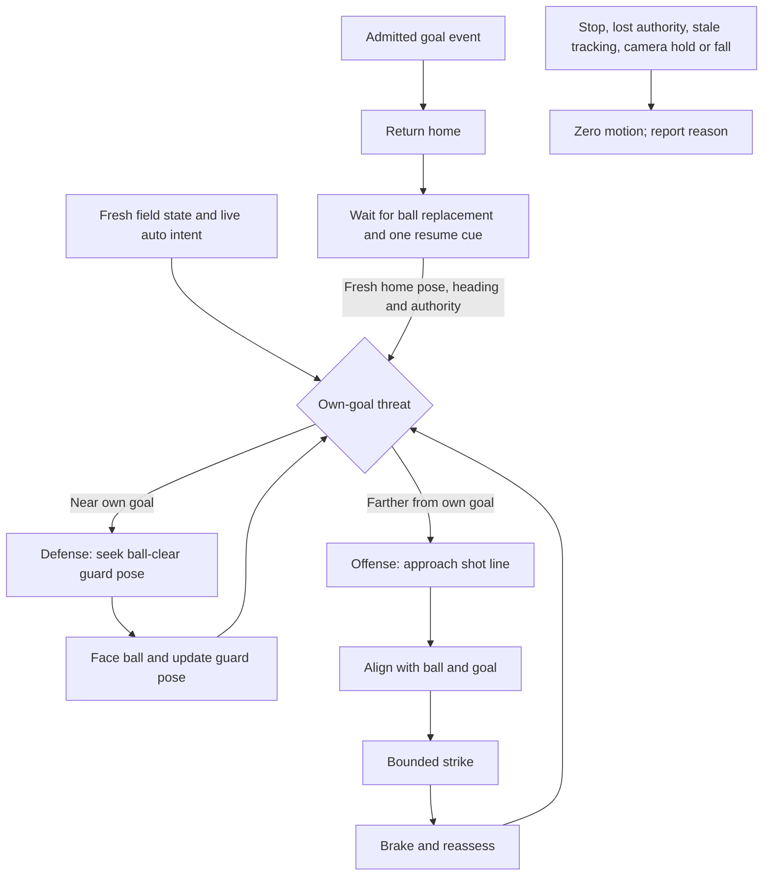

# Offline soccer decision rehearsal

The interactive field defaults to one simulated Pupper steering toward a left-foot shot. It receives metric field position and yaw, steers on fresh observations, slows into the paw contact window and requests one kick. A simulated backend reports clip playback and walker restoration. The ball receives no kick impulse. The viewer can show roles, hold reasons, speed, yaw rate and decision input age throughout.

## Walking and kicking in one release

The `fc_walk_kick` profile runs the field executor, stock walking policy and Tej’s leg kick under one owner. Fresh field observations guide the approach. Once Pupper settles at the selected paw, the runner requests one kick and fences off walking until the native clip and walker recovery are confirmed. Each shot attempt has its own ID. The camera guard continues checking for obstacles during the transition.

In two deterministic starts per foot, all four shots made first contact with the chosen front paw and the restored walker covered 20–21 cm. Three balls completely crossed the goal line. The left kick from an offset start missed. The conservative profile took 8.34 seconds from kick request to walker readiness. The model used a stationary size-five ball and delayed simulated tracks.

The policy physics test runs an approach, measures first contact with the simulated ball, and gives the restored walker a new destination. Run it in the numerical environment with MuJoCo and a C++ compiler. The staged release check compares the selected files with those under test.

```sh
PYTHONPATH=pupper-mjlab/src python foundation/scripts/verify_fc_policy_cycle.py --staged-release "$FC_RELEASE" --output /tmp/fc-policy-cycle.json
```

A separate ROS test exercises the actual native controllers with in-memory joints through an initial velocity command, an applied kick frame and a fresh velocity command after reactivation. The [physics results](../../foundation/results/combined-walk-kick-physics-20261119.json), [native test](../../foundation/results/combined-walk-kick-native-20261119.json) and [Pi release procedure](../ROBOT_BUILD_AND_TEST_HANDOFF.md#combined-walk-and-leg-kick-release) identify the assumptions and deployment steps. Tej measures physical contact and return-to-walk on the selected release.

## One-robot software rehearsal

Run the camera-to-kick matrix from the repo root with the API Python (NumPy is required for Ryan’s tracking filters).

```sh
.venv-api/bin/python -m final_project.pupper_fc.kick_rehearsal
.venv-api/bin/python -m final_project.pupper_fc --kick-side right --headless --scenario offset
```

The matrix exercises the field camera’s actual clock and packet admission, bounded body-frame velocity commands and the exclusive kick handoff. It covers three cruise speeds, several starting poses, both feet, a moved ball, camera loss, noisy tracking, reduced gait response and walking to a new metric pose after the kick. The retained numbers distinguish host processing time from simulated capture age. [Three-speed video](media/three-speed-approach.mp4) · [Case results and source identities](../../foundation/results/field-kick-rehearsal-20261119.json)

In the retained 22-case run, every attempt reached a stationary handoff inside 10.3 mm forward, 7.3 mm sideways and 0.38° heading error in the simulated field. In an angled run, reducing delivered translation to 70% and turning to 65% increased approach time from 4.76 to 6.56 s. The planner used the observed pose to correct the difference. An approach starting on the opposite side of the ball took about 16 seconds. In a separate near-wall example the required paw position fell outside the field and the planner held. These results use provisional paw geometry and synthetic tracks.

In foot mode, `Executor.handle` and `tick` return zero-velocity previews. `kick_step` is the sole output for the walker and kick backend. Renew the same intent ID to refine a metric pose or shot target continuously. One offensive attempt can emit one ticket. A new deliberate attempt uses a new ID. The backend must start before the ticket’s deadline and acknowledge the same side/clip and restored walker. The simulation waits using its virtual clock and keeps processing new observations throughout. A force, torque, contact or physical braking result requires independent measurement.

An additional in-process test takes left and right requests from the field executor through the actual operator endpoint and queue with fake native hardware. The [receipt adapter](operator_kick_receipts.py) accepts evidence for the exact server instance, job, side, clip and restored walker. Source changes do not select a compatible live walking/kick release or dispatch to the Pi. [Operator interface](../../gemini_pupper/README.md#operator-soccer-kick-candidate)

To replay recorded normalized inputs, use `.venv-api/bin/python -m final_project.pupper_fc.integration --replay INPUT.jsonl --kick-side right --robot-id pupper-1`. The file supplies arm, clock, intent and frame events with their original timestamps. Receipts in this replay are simulated.

## Run

From the repository root, using the existing API environment:

```sh
.venv-api/bin/python -m final_project.pupper_fc
```

Open <http://127.0.0.1:8765>. The server binds loopback only; all tabs share one practice session. `--port 8766` selects another port. Stop the server with Ctrl-C. Python changes require a server restart; refresh the page after frontend changes. The [root setup instructions](../../README.md) cover the existing environment; the viewer requires the API environment. Use `--kick-side right` to change feet and `--legacy-run-through` to inspect the historical scoring simulation. Reset practice to begin a new single-shot attempt.

Choose a scenario and attack direction and press **Reset practice**, then **Start**.
Drag the ball or robot, or use the reposition buttons. **Ball near home goal**
exercises automatic defense; **Ball at midfield** lets tactics reconsider offense.
Add observation delay/noise, hide or freeze tracking, or nudge the ball.
While paused, edits update field truth/settings immediately; the observation
remains the last control input until the next tick. **Decision input age** uses
the capture actually admitted by the executor. A changed packet with a reused
capture is rejected and stops motion until fresh evidence arrives.
**Simulate front-camera hold** calls the executor's external interruption path;
it does not run a detector. **Interrupt play instructions** stops intent renewal
while tracking continues, exposing authority expiry independently of perception.

**Pause** freezes simulated time, including lease age. Start from pause continues
the same session. **Stop** cancels authority and commands simulated braking; the
next explicit Start creates a new epoch. Step from a fresh practice arms once and
advances one tick; Step cannot release Stop. An injected fall requests recovery;
clearing that checkbox is operator intervention, not physical get-up.

After a goal, **Replace ball & resume** requires current observed home position
and heading, fresh tracking, a live intent and no external hold. The simulated
ball replacement and executor resume are validated together; refusal leaves the
ball, score and authority unchanged. A new capture may require Step when paused.
An accepted cue does not renew permission, re-arm or reposition the robot.
Reset practice starts a new trial and retains selected tracking/speed/renewal
settings; it explicitly resets the simulated field and injected hold/fall.

The [saved executor rehearsal](../../artifacts/pupper-fc/2026-11-17/executor-viewer-rehearsal-final/pupper-fc-executor-rehearsal.json)
opens through **Open trace**. Its 399 frames show offense, defense, camera hold,
instruction expiry, a naturally simulated goal, return home, one accepted resume
and Stop. Ball relocations are explicit disturbances; no goal is injected and
the robot is never teleported. The trace pins its seven gameplay source files.

**Export trace** saves the latest 2,400 frames (roughly two minutes, less with edits), including truth, observations, decisions, settings, metrics and source hashes captured at process startup. **Open trace** plays those frames locally; it does not rerun the controller or send recorded commands. Live controls are disabled during replay except Stop. Replay does not itself pause the background simulation. Truncated exports say so. Exports are opt-in; raw traces are not automatically added to Git.

```sh
python3 -m final_project.pupper_fc --headless --scenario all --seconds 40
.venv-api/bin/python -m pytest -q final_project/pupper_fc/tests
```

The headless viewer uses the same Sandbox and Executor as the browser. With no explicit foot it retains the historical run-through for comparison. Select a foot for a kick rehearsal. `--seed 12` changes observation noise and `--output /tmp/fc-trial.json` saves a new result file.

## Small integration seams

| Component | Current boundary | Teammate integration |
| --- | --- | --- |
| Perception | `model.Observation`: capture time, robot pose/ID, optional ball position/velocity, fallen flag and goal event | The perception adapter supplies calibrated field coordinates and capture age. Missing data stays missing. The controller never receives simulator truth. |
| Movement | `model.Command`: body-frame forward/lateral/yaw velocity, expiry and robot ID; `model.Limits` | Measured movement limits and a robot adapter replace simulated motion. Enforce expiry at the robot, exclusive command ownership and Stop before hardware use. |
| Shooting | The field target places the chosen paw on the shot line. The kick handoff grants one request and holds walking until the backend reports release. | Tej measures the release’s real paw geometry, ball travel and first recovered step. |
| Gameplay | `Executor` admits field frames and leased intents, then calls its `Controller` | Browser/API use the shared executor; the headless baseline calls the controller directly. The runtime owns simulated operator controls and metrics. |

The [project brief](../README.md) records current owners and agreed outcomes for these interfaces.

Field coordinates are metres, origin at centre, +x right and +y up in the viewer. Heading is counterclockwise radians from +x. Body commands are +vx forward, +vy left and +wz counterclockwise radians/sec. The opponent goal is at `attack_sign * length/2`; tests exercise both attack directions. All timestamps currently use one simulation clock. A real adapter must reconcile camera and controller clocks rather than stamp old frames as new.

`Observation.goal` is a referee event relative to this robot (+1 opponent goal, -1 own goal); the simulator currently supplies it. `fallen` will need a real robot status source. `Controller` returns zero for missing/stale/malformed input, requests recovery for a fall, and aborts a strike if the ball leaves its corridor. Its default freshness threshold is a prototype assumption, not a validated camera budget.

## Shared-state executor and deliberate game resume

Role, action and motion permission are separate. During a live `auto` intent,
each robot's tactics selects offense or defense relative to its own goal. A hold
can preserve that role while issuing zero motion. With Stop or no live automatic
intent, the viewer shows **Unassigned**; that is not a third soccer strategy.
Explicit `move`/`shoot`/`defend` intents use their supplied owner/target instead.



This summarizes the gameplay branches, not a single flat enum: the interruption
gate applies to every moving branch, including return home. Stop needs a new
explicit arm; clearing a camera hold needs fresh evidence and cannot replay an
interrupted finite shot. Fall handling requests recovery; it does not get up.
Role thresholds in `TacticsConfig` are provisional: enter defense within 30% of
field length from the own goal, leave beyond 45%, and bypass the one-second
ordinary role dwell within 14%. No predicted interception is implemented.
The executor's `tick()` and controller's `tick()` remain the exact precedence
definitions. A goal is retained across holds and does not itself grant motion.

`integration.py` provides a transport-free two-robot executor and JSONL replay. It starts stopped; an explicit operator `arm` selects a never-used session epoch and named monotonic clock. Each robot has one expiring intent, capped at 0.5 seconds. `attack`, `shoot`, `move` and `defend` use explicit ownership; an optional `auto` intent lets the existing `Tactics` choose offense/defense from fresh shared field state. Role appears separately from execution phase in each decision. Explicit replacement cancels the previous action, and expired intents never fall back to autonomous play. Defense preserves the guard target's heading during repositioning; ordinary movement faces travel on long moves.

Goal pulses latch only after an entire valid field frame is admitted, even during a lease or camera hold. Motion still requires current authority and fresh evidence. Every action yields to the goal return before using its action target or opponent-goal geometry. Stop, tracking loss, expired intent and a configured camera hold continue to stop motion. Camera configuration remains optional for camera-free replay; configured gates start closed.

Defense requires a visible ball. It preserves a clear guard target or shifts an
occupied nominal target toward its own goal while staying within the field and
goal span. Transit uses ball-clear segments; close retreats preserve heading so
the front does not rotate into the ball. If the target or departure cannot fit,
the decision reports a hold or blocked reason. Ordinary `move` still accepts a
pose without a ball. This is a bounded ball-avoidance heuristic, not an opponent
planner or a guarantee that every geometrically reachable guard will converge.

`Executor(required_participants=("pupper-1", "pupper-2"))` requires both original
pose captures for every action. Present participant rows supply `captured_at`
no later than the enclosing frame. Missing/stale participants produce
`participant_hold`, cancel transient play state and preserve referee events,
role and remaining intent authority. Optional row captures are also honored in
solo mode. Repeated captures cannot change pose or advance alignment evidence;
new-frame goal/fallen flags remain independent. `frame_evidence_deadline()` is a
read-only final-publication fence. This adds freshness, not collision geometry.

After the robot has completed its goal return and the operator has replaced the ball, send one deliberate cue per robot:

```json
{"event":"resume","now":15.0,"epoch":"game-1","clock":"replay","robot_id":"pupper-1","frame_seq":301}
```

`frame_seq` must identify the exact current admitted field frame, with a fresh pose at the robot's home position **and heading**, `fallen=false`, and `goal=0`. A completed goal latch, a live intent, and a clear configured camera gate are required; after a camera hold the field observation must also be new enough for resumption. Refusal returns `accepted=false` and a concrete reason. Resume does not move the ball, arm the executor, renew an intent or switch its owner. It consumes the reset immediately, with no queued request that could erase a later goal. A frame reference can be consumed only once per robot; stale/repeated cues and old epochs cannot clear another goal. This event belongs to the operator adapter, not an upstream perception producer.

```sh
.venv-api/bin/python -m final_project.pupper_fc.integration --replay INPUT.jsonl
.venv-api/bin/python artifacts/pupper-fc/2026-11-17/overnight-execution-review/two_robot_replay.py
```

The second command runs the bounded [two-robot fault experiment](../../artifacts/pupper-fc/2026-11-17/overnight-execution-review/two-robot-summary.json) from the active repository root. Its 30 simulated seconds include delayed/dropped/reordered field frames, lease loss, camera holds, goal pulses, manual replacement/resume cues, a later goal and Stop. It uses ideal kinematic bodies and scripted ball/referee events, with no physical contact or collision model. The saved event stream replays identically. Host execution latency is measured around the software calls and is separate from simulated timestamps and unmeasured camera/transport/robot latency.

## Files and limits

- `model.py`: plain data types and coordinate contract.
- `controller.py`: gameplay geometry/state, no I/O.
- `integration.py`, `tactics.py`, `obstacles.py`: leased shared-state execution, optional role selection, camera hold gate and JSONL replay.
- `simulation.py`: acceleration, friction, simplified bumper/body/wall contact and delayed/noisy observations.
- `runtime.py`: one practice session, operator controls and bounded trace.
- `server.py`, `static/`: local API and dependency-free browser viewer.
- `tests/`: geometry, faults, simulator invariants, closed-loop plays and API checks.

Centered, offset, wrong-side and moving-ball baseline scenarios are covered by score-and-return tests in both attack directions. The [saved validation](validation.json) records 143 passing tests plus 48 subtests, 16 score-and-return trials (including bounded delay/noise trials), two explicitly blocked near-wall trials, source hashes and browser checks. A wall can make the required shot pose unreachable; the controller reports **blocked** instead of attempting extraction. Larger noise/delay can also prevent a useful shot. Treat these as experiments, not guaranteed successes.

The simulator uses assumed footprint, bumper, speed, acceleration, friction and restitution. It omits legs, balance, motor dynamics, real contact variability, opponents and obstacles. Offline defense and camera-gate logic do not establish physical acceptance; physical recovery, real perception and boot-to-ready remain separate work. The existing Lab 6 timed action queue is not used for this continuously replaced motion intent.

The [continuous ROS bridge](../behaviors/README.md#continuous-gameplay-bridge) is
now a separate adapter candidate. It shares one local monotonic clock with this
executor, supplies explicit guard-compatible limits and geometry, and publishes
only its selected robot. Trusted local `set_external_hold()` cancels internal
strike/alignment and requires both field capture and intent issue after release.
Interrupted finite shoot IDs are retired for the epoch; shoots offered while
held are refused without retiring an unused ID. A new arm after prior hold
history sets a new freshness floor. The local physical veto survives Stop and
new epochs until the adapter clears it. This API is not an upstream perception
event. ROS transport checks with synthetic inputs are not physical navigation
or collision-avoidance acceptance.
