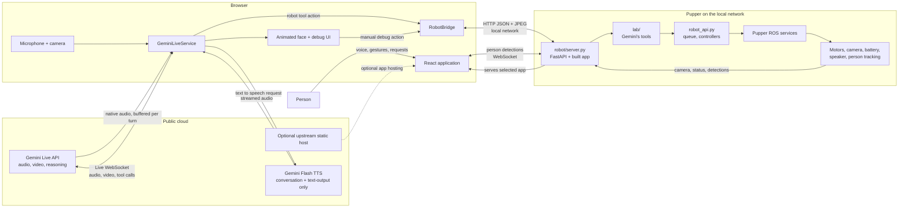
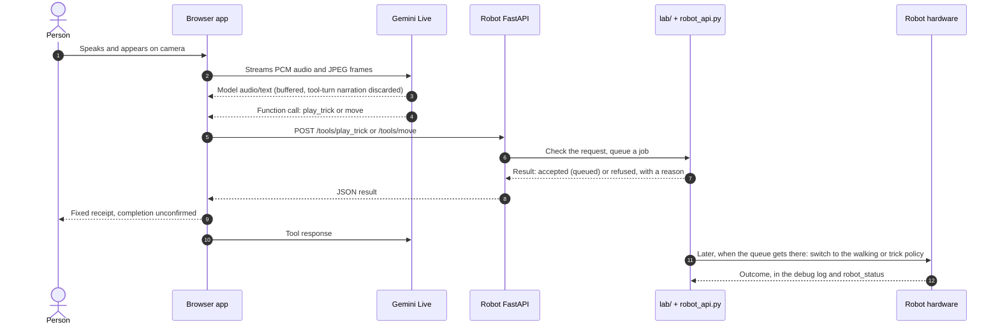
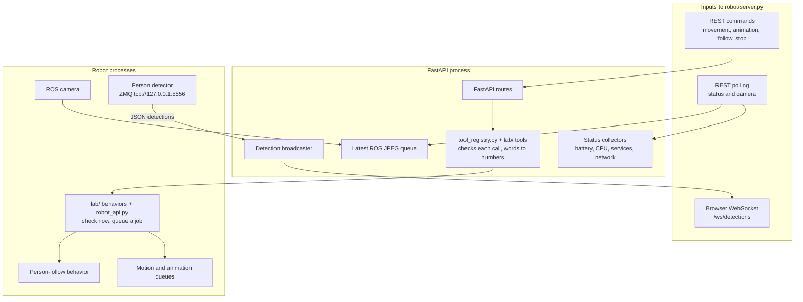
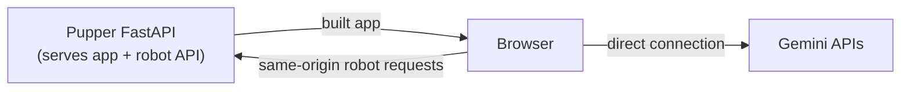

# Gemini Pupper Architecture

The browser connects to Gemini for voice and reasoning and sends robot requests to the local FastAPI server. Use the [hardware checklist](../../foundation/HARDWARE_CHECKLIST.md) for the team's physical session.

## The 30-second explanation

Gemini Pupper is a browser-based voice and vision interface for a robot dog. The browser captures microphone and camera data and streams it directly to Gemini Live. When Gemini decides the robot should move or perform a trick, it returns a structured function call. The browser translates that call into an HTTP request to a small FastAPI server running locally on the robot. That server uses the Pupper ROS stack to queue motion, animation, and follow-person commands.

In the selected setup, the existing FastAPI server serves the built app from the same origin as the robot API. Upstream Cloud Run static hosting is an alternative way to serve the same files. Gemini stays a cloud service in both cases, and the browser coordinates between Gemini and the robot.

The default combines conversation and robot tools in one session. A bounded
client buffer holds model output until the turn ends; tool-bearing turns use
fixed receipts after matching server replies instead of model narration.
Tool-free turns retain native speech after best-effort screening for unsupported
action claims. Queue wording requires the server's `pupper_submission_v1` marker
after insertion. Tool dispatch and direct Stop remain independent of speech
playback. An optional receipt-only diagnostic setting mutes all model narration. See
[operator feedback modes](foundation.md#operator-feedback-modes) for exact limits.

## System at a glance



### Responsibility boundaries

| Area | Responsibility | Important code |
|---|---|---|
| Cloud Run (upstream hosting option) | Builds and serves the static browser application through nginx | Cloud deployment files are not included in this checkout |
| React application | Owns UI state, settings, logs, connection state, and periodic status polling | [App.tsx](../web/App.tsx) |
| Gemini integration | Captures media, opens the Live session, plays audio, executes tool calls, and returns tool results | [web/services/geminiLive.ts](../web/services/geminiLive.ts) |
| Robot bridge | Maps browser operations to the robot's HTTP API | [web/services/robotBridge.ts](../web/services/robotBridge.ts) |
| Robot API | Exposes control, camera, tracking, and telemetry endpoints on the selected listener | [robot/server.py](../robot/server.py) |
| Gemini's tools | The prompt, what Gemini reads about each tool, and what each tool does | [lab/prompt.md](../lab/prompt.md) and the `@tool`s and behaviors in [lab/](../lab/) |
| Robot side | The job queue, the robot's state, leg-controller switching, interactive tricks, falls, follow mode, the e-stop | [robot/robot_api.py](../robot/robot_api.py) |
| Robot stack | Converts high-level requests into queued ROS motion and behavior operations | [Pupper v3 monorepo](https://github.com/Nate711/pupperv3-monorepo) |

## End-to-end conversation and action

The browser owns the live conversation and function-call loop.



A manual button in the debug view enters the same path at the browser-to-robot HTTP step, bypassing Gemini. This makes it useful for checking the robot connection and motion APIs independently.

The command path carries `X-Pupper-Command-Epoch`, obtained from `GET /health`
(or visible in `/queue/status`). The opaque API-instance/Stop-generation token
must accompany every mutating HTTP request except the three Stop routes and
read-only `POST /tools/robot_status`. Missing/stale tokens are rejected before
dispatch with 428/409; clients never automatically retry a motion with a new
token. Stop remains independent of metadata lookup. Browser bridges within the
same page share Stop state per API URL, so switching between manual controls and
a Live session cannot resurrect an old pending request. Epoch rejection pauses
model motion until explicit reconnect; failed/unconfirmed Stop also inhibits new
motion. See [the exact contract and recovery rules](foundation.md#http-command-epoch).

Acceptance, queue completion and physical observation are separate. The server's
`current_action` and `last_outcome` identify current and historical work; unknown
pose, speed and stopping fields stay unknown. Model narration is not a sensor.


## Audio and model modes

Combined conversation/control supports both patterns below, with complete-turn
buffering before model output is released. Any robot tool in the turn replaces
its narration with fixed local receipt speech. No-tool English claim screening
is heuristic; arbitrary conversation is not verified physical evidence. The
buffer adds latency to conversation, not to tool execution. Missing transcripts,
oversized/incomplete turns and cancelled output are discarded.

Receipt-only diagnostics mute both model output patterns. Missing local speech
synthesis leaves visible receipt text; it does not enable model audio as fallback.
Receipt speech is bounded and never awaited by dispatch. Stop/disconnect
invalidate pending receipts and buffered model output.

### Native-audio Live models

Gemini 3.1 Flash Live and Gemini 2.5 Flash Native Audio return audio directly through the Live session.

```text
microphone -> browser -> Gemini Live -> native audio -> browser speakers
```

The separate `speak` tool is intentionally not advertised to native-audio models.

### Text-output robotics model

The Robotics ER streaming model returns text and can call the `speak` tool. The browser sends that text to the selected Gemini Flash TTS model and plays the returned audio.

```text
robotics model text -> speak tool -> Gemini Flash TTS -> browser speakers
```

Gemini 3.1 Flash TTS is consumed as a stream, so playback can begin before the entire utterance has been generated. Gemini 2.5 Flash TTS uses a complete-response request because that model does not support TTS streaming.

## Robot-side architecture

The robot server is a translation and observation layer between browser-friendly protocols and the Pupper ROS environment.



### Robot command API

| Purpose | Method and path | Browser caller |
|---|---|---|
| Gemini's prompt and tools | `GET /tools` (lab/prompt.md, the tools in lab/) | Session setup |
| Run one of Gemini's tools | `POST /tools/<name>` | Every Gemini tool call |
| Queue stand or lie-down behavior | `POST /walking/activate`, `POST /walking/deactivate` | Manual/API controls |
| Move with velocities | `POST /move/velocity` | Debug controls |
| Move by heading | `POST /move/direction` | Directional debug control |
| Stop or clear work | `POST /queue/stop`, `POST /queue/reset`, `POST /stop/immediate` | Safety and debug controls |
| Play one whole routine | `POST /animation` | Debug controls; rejects extra quantity fields |
| Follow a person | `POST /following/activate`, `POST /following/deactivate` | Follow-mode tool |
| Read camera | `GET /camera/image` | Debug view and optional Gemini vision source |
| Read API/epoch readiness | `GET /health` | Command preparation |
| Read execution state and epoch | `GET /queue/status` | Execution-status polling |
| Read system telemetry | `GET /system/status` | Face warnings and debug status bar |
| Track a person | `WS /ws/detections` | Animated eye direction |
| Set speaker volume | `POST /system/volume` | Debug control |

The animation endpoint plays a trick from `tricks/` by id, such as `sneeze` or `swim`. Every trick is played by policies, so playing one switches the legs to that trick's controller (or, for the jump, feeds a reference to the locomotion policy), and the command queue waits for the trick to finish so later actions do not overlap it. The robot is always in exactly one state: locomotion, one trick (trick mode), motors idle, or fallen.

### Camera and person tracking

There are two distinct visual paths:

1. **Vision sent to Gemini:** The app can use the browser camera or poll `/camera/image` from the robot. Frames are resized, JPEG-compressed, and sent to the Live session.
2. **Eye animation:** The face can track the mouse, run MediaPipe in the browser, or consume person detections from the robot. In robot mode, a local detector publishes JSON over ZMQ; the FastAPI process forwards it to the browser over `/ws/detections`.

These paths are independent: changing the animated-eye tracking source does not necessarily change which camera Gemini sees.

`/camera/image` preserves the JPEG/503 interface but requires a valid ROS callback
receipt no more than two seconds old, rechecked after processing, with no-store
responses. Polling never refreshes the timestamp. The browser logs server-camera
availability changes without allowing a late old response to overwrite newer
state. Earlier images may remain in the model context; receipt age cannot prove
exposure age or detect an upstream publisher replaying old content.

### Telemetry

The robot API assembles status from several local sources:

- Battery percentage and voltage from the Pupper battery utility
- CPU utilization and temperature through `psutil`
- Robot service state through `systemctl is-active robot`
- Internet reachability through a short socket connection test

The main application polls slowly for critical warnings, while the debug panel polls more frequently for operator feedback.

## Deployment and network topology



Robot traffic stays between the browser and the local FastAPI server. Upstream static hosting, such as Cloud Run, is an alternative. It needs a compatible API origin that the browser can reach, and browser mixed-content and local-network policies must allow that connection.

## Trust and safety boundaries

- CORS uses `allow_origin_regex` to allow `localhost` and `127.0.0.1` with an optional port.
- CORS and command epochs do not authenticate anyone. Epochs only stop stale commands from being dispatched.
- The project's bootstrap gives a one-time localhost grant that delivers the existing Gemini key into browser memory. Browser settings off the robot can store the key persistently.
- Limit the API to a trusted host or network.
- API Stop cancels work and requests zero velocity. The operator retains R3 and the power disconnect during motion.

## Startup lifecycle

Staging and preparation operate on files. A supervised operator then runs `start-native` explicitly, and this step may home the robot. The operator starts the API separately after native readiness. FastAPI's HTTP listener port is configurable, and 8000 is only the class default.

The user then opens the selected app over loopback on the robot and connects the microphone and voice explicitly. Match the served bundle and API instance against the selected release before sending commands. For physical runs, Stop and shutdown, follow the [hardware checklist](../../foundation/HARDWARE_CHECKLIST.md).

`robot/start.sh` is an optional, separate class launcher. Never use it to restart the app.

## Failure isolation

| Symptom | Likely boundary to inspect |
|---|---|
| Page does not load | Selected API origin, built web assets and browser cache |
| Camera or microphone unavailable | Browser permissions, HTTPS secure context, Linux audio/video devices |
| Gemini connects and immediately closes | Model ID, API key, unsupported Live configuration; inspect close code in debug logs |
| Voice works but robot does not move | Robot API URL, LAN access, CORS/mixed-content policy, the selected run’s API log |
| Manual controls work but Gemini actions do not | Gemini function declarations and tool-call handling |
| Robot moves but eye tracking is absent | ZMQ detector, port 5556 publisher, `/ws/detections` |
| Debug status is empty | `/system/status`, robot service, battery script, network reachability |

## Offline media and timing evidence

The [isolated browser rehearsal](foundation.md#synthetic-browser-media-rehearsal)
uses this production service with synthetic WebAudio/canvas video, mock Google
messages and a strictly fake localhost API. Actual Chrome tested PCM capture,
changed JPEG content, Stop during blocked WAV decode, cancellation and cleanup,
including a conversion completing after disconnect. A sequence guard prevents
older asynchronous frames from being sent after newer frames or a later server
unavailability response. The separate receipt-age gate is not exposure validation. Separate actual Google probes tested synthetic spoken
Stop during model audio/fake work and interpretation of synthetic JPEGs. These
are not real microphone/camera or physical robot validation.

An optional metadata-only timing callback in `GeminiLiveService` distinguishes
capture, SDK invocation, received-message callbacks, tool responses and audio
handling using a monotonic clock. It stores no audio, transcript or tool arguments.
SDK return and queued playback do not establish network receipt or audible output.
The [Stop/grounding report](../../foundation/results/workstream1-stop-grounding-20261030.json)
keeps measurements, source identities and unsuccessful cases together.

## Related documentation

- [Project overview and setup](interactive-robot-dog.md)
- [Robot-side server](../robot/server.py), [the lab: tools and behaviors](../lab/), [the Robot API](../robot/robot_api.py)
- [Repository README](../README.md)
- [Pupper v3 robot stack](https://github.com/Nate711/pupperv3-monorepo)
