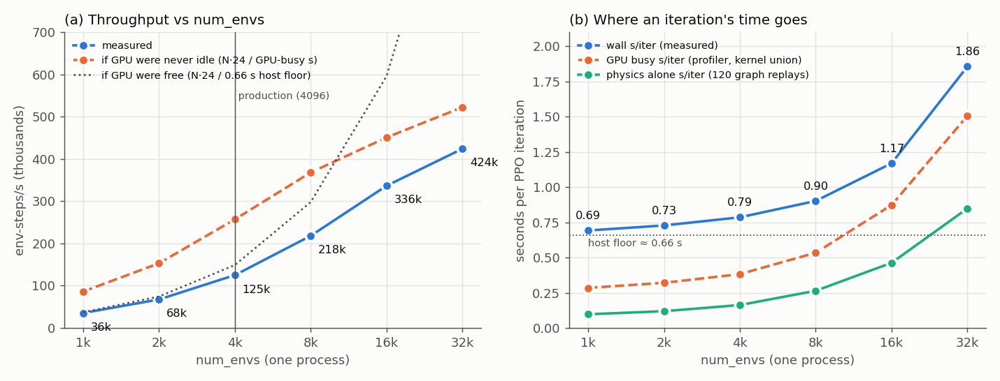

# What bounds PPO training throughput on the A100

Measured 2026-11-19 on the same 1× A100-PCIe-40GB as `a100_throughput.md` (driver 570.195.03, 250 W cap, SM clock 1410 MHz, PCIe Gen4 x16) with an AMD EPYC 7H12 VM (30 vCPU). Stack: torch 2.9.0+cu128, warp 1.14.0, mujoco-warp 3.10.0.2. Sim-only infrastructure evidence. No training runs, no checkpoints.

## Verdict

**At 4096 envs, throughput is bound by the single host thread.** That thread runs Python plus PyTorch eager dispatch and kernel launches, and it blocks on device→host syncs. It is not bound by GPU compute, memory bandwidth, memory capacity or PCIe.

- **The host thread is pinned.** The training process's main thread runs at 99–100 % of one core, and every other thread is idle.
- **Per iteration it issues** about 55 k GPU kernels (≈ 34 k `cudaLaunchKernel`, 1.2 k warp launches and 192 CUDA-graph replays) and about 2,600 `cudaStreamSynchronize` calls. That is roughly 2,300 kernels and 110 syncs per env step.
- **The GPU is mostly idle.** At 4096 it runs kernels for 0.38 s of a 0.79 s iteration (49 %). DRAM-controller utilisation is 7 %, board power is 93 W of 250, and PCIe carries about 0.1 GB/s. Torch reserves 1.2 GB (3.7 GB per process in `nvidia-smi`) of 40 GB.
- **Did we reach that bound? Yes.** The host-only floor, extrapolated to num_envs → 0, is ≈ 0.66 s/iter. 4096 runs at 0.79 s, which is 84 % host floor and 16 % GPU time exposed at syncs. The **GPU** was nowhere near its limit. 4096 delivers 125 k env-steps/s, while the same process at 32768 envs delivers 424 k (3.4×), and even there the GPU is only 81 % busy.
- **Concurrency cannot recover the idle GPU.** Each process has its own CPU core, so the host side would parallelise. The GPU, however, time-slices CUDA contexts, and each of the ~2,600 syncs per iteration waits for its context's turn. Two concurrent 4096 processes gave **113 k** aggregate env-steps/s, against 125 k solo (−10 %). `nvidia-smi` showed 100 % "SM" during that run while power (96 W) and memory utilisation (6 %) stayed at solo levels. More slicing, not more work.

## Evidence

### Setup

- `scripts/opt_lab_2/gpu_bench.py` builds exactly the env and runner that `pupper_locomotion train` builds, with the Part 1 production flags: task `Mjlab-MixedGaits-Flat-Pupper-v3`, `fast_trot` reference, `splay` weights, deployment clamp, driver limits, COM composition and torso hull. It then runs a line-for-line copy of `OnPolicyRunner.learn` with host-side phase timers. The timers do not add syncs; there is one `cuda.synchronize()` per iteration, after `update()`, where `.item()` already syncs.
- Each config ran 5 warm-up iterations, then 30 timed iterations (20 for 32768 and the mini-batch variants); the table reports medians. The actor observation is 960-dim, the critic's 84-dim, with a [256,128,128,128] ELU MLP, 24 steps/env, 5 epochs × 4 mini-batches and 5 physics substeps per env step.
- `scripts/opt_lab_2/gpu_bench_sweep.py` launches each config through `gpu_slot` (the shared lock) only when no foreign GPU process is present. Alongside each run it records `nvidia-smi dmon -s puct` at 1 Hz (windowed to the timed iterations), `pidstat -t` (per-thread CPU) and the compute-app PIDs.
- GPU-busy time comes from `torch.profiler` (CUPTI) over 2 extra iterations (1 at 32768): the union of all kernel intervals, including warp and CUDA-graph kernels. Profiled iterations are excluded from the timing medians, because the profiler slows the host by about 0.6 s/iter. Kernel durations are not affected.
- **Background load, labelled.** Two long-running viser viewer processes (PIDs 298069 and 298106, 2.5 GB and 0.6 GB) were on the GPU for every measurement. Measured alone just before the sweep, they drew **0 % SM, 0 % mem and 36 W** (idle) over 20 samples. No other foreign process appeared in any timed window (`*.apps`). The 4096 result reproduces the earlier clean solo benchmark (0.786 vs 0.78 s/iter) and the 8192 result matches the earlier 218 k env-steps/s exactly. The viewers therefore did not measurably distort these numbers. Two smoke runs (sync-site counting, 512/1024 envs) shared the GPU with a push eval; they are used only for call counts, not timing.
- `nvidia-smi dmon` on A100 has no GPM metrics (SM occupancy and DRAM activity need Hopper), and `nsys`/`ncu` are not installed. "SM %" is therefore the kernel-active time fraction and "mem %" the memory-controller busy fraction. Saturation was established by scaling num_envs instead.

### Scaling num_envs (one process, idle GPU apart from idle viewers)

| num_envs | s/iter | collect / learn s | env-steps/s | GPU busy s/iter (profiler) | GPU busy % of wall | physics alone s/iter¹ | SM % | mem % | power W | main-thread CPU % | torch mem GB |
|---|---|---|---|---|---|---|---|---|---|---|---|
| 1024 | 0.692 | 0.507 / 0.185 | 36 k | 0.285 | 41 % | 0.098 | 42 | 2 | 70 | 100 | 0.3 |
| 2048 | 0.728 | 0.542 / 0.186 | 68 k | 0.321 | 44 % | 0.119 | 48 | 4 | 78 | 100 | 0.7 |
| **4096** | **0.786** | **0.593 / 0.191** | **125 k** | **0.382** | **49 %** | **0.163** | **55** | **7** | **93** | **99** | **1.2** |
| 8192 | 0.902 | 0.692 / 0.209 | 218 k | 0.534 | 59 % | 0.264 | 66 | 14 | 124 | 99 | 2.5 |
| 16384 | 1.169 | 0.908 / 0.261 | 336 k | 0.872 | 75 % | 0.462 | 80 | 24 | 153 | 99 | 4.7 |
| 32768 | 1.855 | 1.427 / 0.428 | 424 k | 1.506 | 81 % | 0.848 | 88 | 32 | 188 | 99 | 9.3 |

¹ `sim.step()` alone (one CUDA-graph replay of mujoco-warp's step), synchronized, × 120 substeps per iteration. GPU busy is the union of kernel intervals. It also includes the profiler's `Optimizer.step` GPU annotation spans, which adds ≤ 0.02 s/iter.

Per-iteration iteration-time spread at 4096 was 0.757–0.839 s. PCIe rx/tx stayed ≤ 94 / 20 MB/s at every size, against a link that carries about 25 GB/s.



How to read it:

- **The work does not change with num_envs.** The kernel count (53 k → 56 k) and sync count (2.2 k → 2.6 k) per iteration are nearly constant, and so is host CPU time per phase. Policy `act` costs 23 ms/iter and `process_env_step` 23 ms at every size up to 8192. Only the kernel *durations* grow.
- **Two regimes.** Wall time ≈ a 0.66 s host floor plus the GPU work that sticks out past it at sync points.
  - Up to 8192 the floor dominates. Going 1k → 8k multiplies the envs by 8 and the wall time by 1.3.
  - From about 16 k on, the GPU dominates. Under the profiler, host time spent inside `cudaStreamSynchronize` rises from 0.03 s/iter at 4096 to 0.86 s/iter at 32768, which shows the host waiting for the GPU.
  - The crossover, where GPU busy ≈ host floor, is between 8 k and 16 k envs.
- **Physics is not the bottleneck at 4096.** The mujoco-warp step costs 0.163 s/iter of GPU time, 21 % of the wall, and only 7 ms/iter of host time thanks to CUDA graphs. The rest of the GPU time is about 30 k tiny eager-PyTorch kernels. The top kernels by time are generic `elementwise` and `index_elementwise`, at about 4.5 k launches each per iteration and 5–7 µs average. Physics kernels (`contact_sort`, `ray_bvh`, `ccd`) only dominate from 16 k on.
- **"Did we saturate the GPU?"** No, not even at 32768: the GPU is 81 % busy, mem 32 % and power 188 W. Env-steps/s is still rising, from 336 k to 424 k, but sub-linearly. The ceiling `N·24 / GPU-busy` is 522 k at 32 k.

### Where the host time goes (4096, cProfile, 3 iterations, 0.84 s/iter under cProfile)

| Host phase per iteration | s | Notes |
|---|---|---|
| `env.step` × 24 | 0.567 | 23.6 ms per env step |
|   `_reset_idx` (episode resets, every step) | 0.137 | Includes per-term reward/termination/command `.item()` logging |
|   observation manager | 0.112 | 960-dim history obs |
|   command manager | 0.072 | |
|   `write_data_to_sim` (×6 per step) | 0.065 | |
|   event manager | 0.053 | |
|   `scene.update` (contact sensors, ×5 per step) | 0.045 | |
|   reward manager | 0.041 | |
|   `sim.sense` | 0.034 | |
|   `sim.step` (120 graph launches) | **0.007** | Physics is nearly free on the host |
| policy `act` + `process_env_step` + logger | 0.050 | |
| PPO `update` (20 mini-batch steps) | 0.19 | Autograd backward alone is 0.10 s of host time. About 9 ms per mini-batch step regardless of size (see below) |

Sync sources: `Tensor.item`/`__bool__`/`nonzero`/`.cpu` called directly account for about 510 syncs per iteration. The largest are `check_nan` (96), command/termination reset logging (80), `nonzero` in `env.step` / command resampling (≈100), rsl_rl logger (72) and PPO update (≈100). The rest of the ≈ 2,600 come from inside torch ops such as boolean-mask indexing. Counts are from `gpu_bench.py --sync-sites` (1024 envs; per-iteration counts don't depend on num_envs).

### Learning phase: mini-batch count (4096 envs, otherwise identical)

| num_mini_batches (size) | s/iter | learn s | Δ wall vs production |
|---|---|---|---|
| 4 (24.6 k): production | 0.786 | 0.191 | — |
| 2 (49 k) | 0.677 | 0.100 | −14 % |
| 1 (98 k) | 0.647 | 0.068 | −18 % |

The update is also launch-bound. Its time scales with the *number* of optimizer steps (20 / 10 / 5), not with mini-batch size: a 4× larger mini-batch step costs 13 ms vs 9 ms.

### Concurrency (2 × 4096 started together, plain processes, no MPS)

| | s/iter per process | collect / learn | aggregate env-steps/s | SM % | mem % | power W |
|---|---|---|---|---|---|---|
| 1 process | 0.786 | 0.593 / 0.191 | 125 k | 55 | 7 | 93 |
| 2 processes | 1.743 | 1.51 / 0.235 | 113 k | **100** | 6 | 96 |

The production logs show the same mechanism at 3 concurrent runs (`rp-p1-baseline-s42.log`, iterations 1000–2000): collection went from 0.67 to 2.34 s (×3.5) while learning only went from 0.19 to 0.26 s. Collection is where ~95 % of the syncs are, and each sync waits for its context's time slice. Production solo (`rp-p1-fast_trot-s43`) ran 0.86 s/iter, 0.67 + 0.19 s. The 0.07 s gap to this benchmark comes from W&B logging and the per-50-iteration checkpoint+export. The ~1.0–1.1 it/s whole-GPU production figure additionally includes evals and startup (≈ 30–39 s per process here).

## Practical implications

| Lever | At equal iterations (our rule) | At equal env-steps | Changes PPO numerics? |
|---|---|---|---|
| **8192 envs** | **+15 % wall** (0.90 vs 0.79 s/iter) for 2× samples per update | **1.74× faster** | Yes: batch and mini-batch 2×. Not comparable with the 4096 lineage |
| 16384 envs | +49 % wall | 2.7× faster | Yes |
| 32768 envs | +136 % wall | 3.4× faster | Yes |
| Fewer, larger mini-batches (4 → 2 / 1) | −14 % / −18 % wall | same | Yes: 20 → 10 / 5 gradient steps per iteration |
| Fewer concurrent processes | ≈ 0 to +10 % aggregate (serial is not worse) | same | No |
| More concurrent processes | ≈ 0 to −10 % aggregate | same | No |
| MPS | Untested here, and ruled out by policy. It is the mechanism that would let concurrent processes overlap kernels instead of time-slicing | — | No |
| **Cut host overhead**: remove per-step syncs (`len(nonzero)` gates, `.item()` reset logging, `check_nan`), CUDA-graph or `torch.compile` the manager step | Up to ≈ 2× at 4096 (wall → GPU-busy 0.38 s) if fully hidden. Less in practice | same | No |

- **Under the fixed-iteration rule, nothing cheap speeds up the 4096 recipe without changing PPO numerics.** Every flag-level lever either keeps the per-iteration cost (process count) or changes the batch or gradient-step count (num_envs, mini-batches).
- **8192 is close to free at equal iterations, but not free:** +15 % wall per iteration buys twice the samples per update. The red-team note's "+0 to +15 %" is confirmed at the upper end.
- **The "2× the whole GPU" claim is confirmed in kind.** One 8192 process gives 218 k env-steps/s, 1.74× the 125 k of solo 4096 and 1.9× the 113 k of 2 × 4096. Production's 105–115 k makes it about 2×.
- **For a new lineage that may change the recipe** (equal env-steps), 16 k–32 k envs in a single process is where this GPU starts to be used: 2.7–3.4× the env-steps/s of 4096. That only pays if PPO at those batch sizes learns as fast per sample, which is untested here.
- **The only numerics-neutral speedup is engineering on the host path.** CUDA graphs are already on for physics, so the remaining host cost is the eager-PyTorch manager glue (≈ 0.5 s of the 0.79 s) and its ~110 syncs per env step. That is an mjlab change, not a config flag, and is not attempted here.
- **Budgeting stays as in `a100_throughput.md`:** about 1.0–1.1 it/s for the whole GPU at 4096 in production, independent of process count.

## Reproduce

```bash
cd pupper-mjlab
# one config (any foreign GPU process will contaminate the timing)
.venv/bin/python scripts/opt_lab_2/gpu_bench.py --num-envs 4096 --iterations 30 --warmup 5 \
  --profile-iters 2 --physics-bench --out <scratch>/e4096 --json <scratch>/e4096.json
# sweep through the shared GPU lock, waiting for an idle GPU (PIDs in --background are tolerated)
.venv/bin/python scripts/opt_lab_2/gpu_bench_sweep.py --root <scratch> --background <viewer pids> \
  --config "e4096=--num-envs 4096 --iterations 30 --warmup 5 --profile-iters 2 --physics-bench" ...
.venv/bin/python scripts/opt_lab_2/gpu_bench_report.py <scratch> report/infra/gpu_bottleneck.png
```

Extra options: `--sync-sites` (sync call-site counts), `--cprofile K` (host function breakdown), `--mini-batches M`, and `--concurrent N` on the sweep. The per-config summary (medians, dmon windows, pidstat, profiler counts) is in `gpu_bottleneck_data.json`. Raw logs, dmon and pidstat traces are in `~/runs/opt-lab-2/bench/gpu/sweep/` (not committed).
