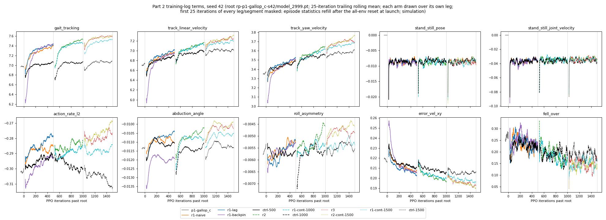
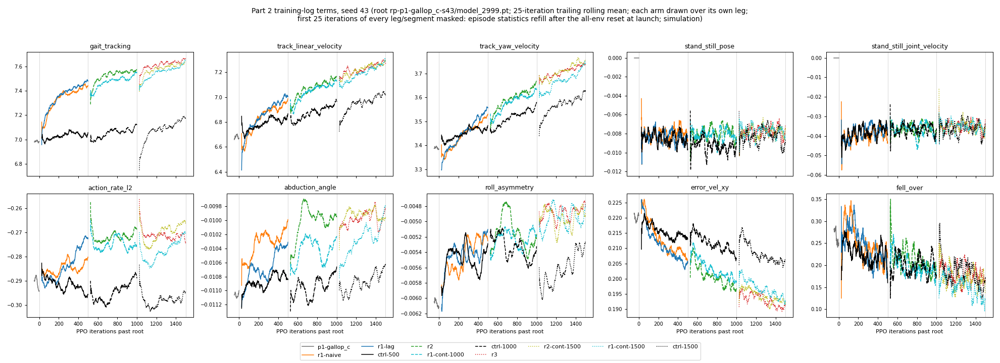

# Part 2 lab notebook: reference bootstrapping on gallop_c (reproduction, W3)

Task `Mjlab-MixedGaits-Flat-Pupper-v3`. Spec: [Opt Lab 2, Part 2](https://cs123-stanford.readthedocs.io/en/latest/schedule/labs/fall-26/opt-lab-2.html).
Started 2026-11-18. This redoes the lost Part 2 ([REPRO_PLAN.md](REPRO_PLAN.md) §2.3–2.5) with a second seed added. Everything
below is **simulation evidence only**.

Tags: **[R]** recovered from the old run, **[N]** new in this reproduction, **[M]** measured here.

Status (2026-11-18 21:20 UTC): all 21 legs trained and evaluated at two seeds. Final policy decided
(4/4 lenses + synthesizer): **`~/runs/opt-lab-2/rp-p2-s42-r2-cont-1500/model_4496.pt`** (WandB `wmhcp24q`), reference
`configs/opt-lab-2/p2/s42/r2-lag` @ `60ce5a4`. See §8 and [the decision](decisions/2026-11-18-w3-final-policy.md).

## 1. Setup

| Item | Value |
|---|---|
| Parent (s42 lineage) | `gallop_c` s42, `~/runs/opt-lab-2/rp-p1-gallop_c-s42/model_2999.pt`, WandB `1c5r0n8c` ([decision](decisions/2026-11-18-p1-parent-gait.md)) |
| Parent (s43 lineage) | `gallop_c` s43, `~/runs/opt-lab-2/rp-p1-gallop_c-s43/model_2999.pt`, WandB `y38xkkvh` ([decision](decisions/2026-11-18-w3-s43-lineage.md): own parent, own capture, 2/2 graders) |
| Parent reference | `configs/opt-lab-2/gallop_c` @ `e01364f` (3.0 Hz clock, `frequency_mult` 2.25) |
| Weights (every Part 2 leg) | `configs/opt-lab-2/weights/splay_stand_still.json` = the parent's `splay.json` + `stand_still_joint_velocity` −0.1 + `stand_still_pose` −0.5 [R] |
| Leg | 500 PPO iterations, 4096 envs, `--profile baseline`, standard physics flags, warm start (optimizer state kept; no airborne pretrain) via `scripts/opt_lab_2/launch.py` |
| Fold (every round) | `lag`, fixed 2-step shift, median, 6 harmonics, no symmetrize, all four `leg_*_2` pinned to the parent ([decision](decisions/2026-11-18-w2-fold-default.md)) |
| Capture | ±1.5 m/s constant command, 64 envs × 15 s each, first 3 s after a change/reset dropped, heading hold off (`part2_reference capture`) |
| Eval | W2 suite (384 robot-runs) + push test, each checkpoint with the reference it trained on ([metrics decision](decisions/2026-11-18-w2-eval-metrics.md)) |
| Orchestration | `scripts/opt_lab_2/part2_queue.py` (DAG: capture → fold → gate → commit+push reference → leg; GPU cap 4 across agents; crash resume), `part2_evalq.py`, `part2_analysis.py` |

**Why a control.** The parent trained on `splay.json`; every Part 2 leg uses `splay_stand_still.json`. The control
arm (parent reference, same new weights, same extra iterations) isolates the reference change from the weight change
and from the extra training (REPRO_PLAN §3).

## 2. Round 0: is gallop_c foldable? [M]

The parent decision flagged the fold as the top risk: Part 1's contact-based footfall labelling reported gallop_c
stepping at 4.2–4.5 Hz against a 3.0 Hz clock with an irregular cycle, so a clock-phase fold might smear it.
I captured both parents at ±1.5 m/s and folded each with the default, plus three diagnostic variants
(auto lag, naive, unpinned). Extra diagnostics come from `scripts/opt_lab_2/part2_foldcheck.py`
(`report/part2/foldcheck/p0-gallop_c-s4{2,3}*.json`).

| Check (per direction fwd / back) | s42 capture | s43 capture | Pass rule |
|---|---|---|---|
| Steady samples, clean cycles, falls, vx | 38.4k / 38.3k, 2175 / 2174 cycles, 2 / 3 falls, vx +1.56 / −1.53 | 38.3k / 38.3k, 2172 / 2176, 5 / 3 falls, vx +1.55 / −1.51 | ≥ 20 clean cycles |
| Joint spectrum (512-step Hann windows, 0.1 Hz bins) | peak **3.03 Hz** (= clock), 2nd harmonic 6.0 Hz at 0.64–0.74 of the peak, **power at 4.2 Hz ≈ 0.001** | same (dominant 2.93 Hz at 0.2 Hz bins) | joints locked to the 3.0 Hz clock |
| Debounced touchdowns per foot | 3.5 Hz (raw contact edges 5.6–7.4 Hz: two contacts per stance) | similar | — |
| Measured lag (auto, steps) | 2.09 / 1.83 | 2.13 / 1.76 | \|auto − 2\| ≤ 0.5 |
| Fold dispersion, wrap closure (rad) | 0.061 / 0.068, 0.003 / 0.004 | 0.060 / 0.061, 0.003 / 0.002 | — |
| Flagged channels (default 4 pins) | none | none | none |
| Unpinned fold flags | all four `_2` fwd, front `_2` back (captured `_2` range 0.29–0.36 rad vs parent 0.015 / 0.059) | same | pin set confirmed |
| Fold residual, RMS q − ref(clock − 2 steps) | **0.097 / 0.094** (parent table 0.141 / 0.144) | **0.097 / 0.087** (parent 0.144 / 0.144) | fold explains the capture better than the parent |
| R² of captured motion (moving channels) | default 0.68 / 0.64; unpinned 0.89 / 0.85; parent 0.59 / 0.50 | 0.68 / 0.64; 0.89 / 0.87; 0.58 / 0.49 | — |
| Amplitude retention (table range / captured 5–95 % range) | unpinned 0.96 / 0.95 (default 0.70, lowered by the pins only) | 0.95 / 0.95 | no smearing |
| kp·Δq proxy (kp 5.5, 20 ms) | **2.17 / 2.53 Nm** (parent 3.82) | **2.21 / 2.55 Nm** | < 3 Nm |
| Peak joint speed | 20.5 / 24.4 rad/s (parent 44.8) | 20.6 / 23.8 | — |
| Driver-limit margin | ≥ 0.31 rad | ≥ 0.31 rad | ≥ 0.05 rad |
| Loader verify | ok | ok | ok |

**Verdict: the fold is not broken.** The "4.2 Hz" in Part 1 came from contact-edge counting: the policy makes two
contacts per stance, which the footfall classifier read as a faster stride. The joint trajectories are locked to the
3.0 Hz reference clock (the spectral peak sits on the clock bin and there is no power at 4.2 Hz), so a clock-phase fold
is the right tool. Its residual is lower than the parent table's, nothing is smeared, the lag fit brackets 2.0, and the
folded table needs **less** torque than the parent reference (kp·Δq 2.2–2.5 vs 3.8 Nm): the policy runs a lower-amplitude
version of the authored gallop. No fold-variant decision was needed, and the parent-gait flip condition ("capture
fails periodicity, residual or limits, or kp·Δq rises well above 4 Nm") is not met.

Two checks confirm the timing convention independently. The parent table predicts the capture with R² 0.59 at a 2-step
shift and −0.24 at zero shift; the naive fold predicts it with R² 0.63 at zero shift (`*-naive-lag0.json`).

The pins carry a real cost: the policy moves its abduction joints 0.29–0.36 rad (5–95 % range) while the pinned reference
moves them 0.015–0.06 rad, so the pins keep 30 % of the captured variance out of the reference. That is the decided
trade-off (the unpinned fold reproduces the recovered crouch-collapse signature on all four `_2` channels).

## 3. Rounds: hypothesis, comparator, metric

Written before any Part 2 eval landed. "Better" means a two-seed mean delta vs the same-seed control that agrees in sign
at both seeds and is outside the noise band (single-eval falls ±10–15; other bands from the repeat evals in §5).
**sat@1.5 is a hard gate**: an arm that raises it beyond noise vs its matched control cannot be the final policy.

| Arm (both seeds unless noted) | Built from | Hypothesis | Comparator (matched) | Primary metric | Secondary |
|---|---|---|---|---|---|
| `r1-lag` | capture of the parent, default fold | A reference the policy can actually follow (lower amplitude, kp·Δq 2.2–2.5 Nm) improves high-speed tracking without costing falls or torque [R: 0.241 → 0.233 training err_xy] | `ctrl-500` | err ±1.5 | falls, sat@1.5, F_runmax, push |
| `r1-naive` | same capture, no lag shift | Without the 2-step shift the reference runs 2 steps (≈ 12 % of the 16.7-step cycle) late, which the policy must undo, so it tracks worse than `r1-lag` | `r1-lag`, `ctrl-500` | err ±1.5 | gait_tracking reward |
| `r1-backpin` (s42 only) | default fold with only the back `_2` pinned | Ablation of the front-abduction pin: unpinned front `_2` shifts by ≈ its range; expected tie or worse splay | `r1-lag`, `ctrl-500` | splay, falls | err ±1.5 |
| `ctrl-500/1000/1500` | parent reference | Effect of the stand-still terms + longer training alone [R: most fall/jitter gains come from here] | parent (+0) for the weight change; itself across levels | falls, jitter | push_stand@0.65 |
| `r2` | capture of `r1-lag` | A second capture moves the reference less (fixed point near) and adds a smaller tracking gain | `r1-cont-1000`, `ctrl-1000` | err ±1.5 | falls, sat@1.5 |
| `r1-cont-1000/1500` | `r1-lag` continued, same reference | Separates "new reference" from "more iterations on the round-1 reference" | `r2` / `r3`, `r2-cont-1500` | err ±1.5 | falls |
| `r3` | capture of `r2` | Diminishing returns: r3 ≈ r2-cont [R] | `r2-cont-1500`, `r1-cont-1500`, `ctrl-1500` | err ±1.5, falls | sat@1.5, F_runmax |
| `r2-cont-1500` | `r2` continued | The old final pick [R] | `r3`, `ctrl-1500` | as above | |
| stand-still terms (all arms vs parent) | — | Stand-still terms make standing push recovery worse [R: 6.7–10.4 % vs 5.4 % falls/push] | parent (+0, `splay.json`) — no iteration-matched `splay.json` arm exists | push_stand@0.65 | jitter |

## 4. Runs

All 21 legs ran to their target iteration with **no crash and no resume** (one segment each), 4096 envs,
`splay_stand_still.json`, 500 iterations each, chained so the final indices are 3498 / 3997 / 4496 at +500 / +1000 / +1500.
Run dirs `~/runs/opt-lab-2/rp-<name>/`; WandB project `photon_mz-stanford-university/mjlab`, tags `rp, part2, w3`.
`launch.py` refused any unpushed input, logged the reference dir and weights as WandB artifacts, and recorded the
git SHA. No training code changed between launches (the only `src/` changes on the branch in this window are W4's new
`part3_*.py` scripts, which training does not import).

| Leg | WandB | Warm start from | Reference (commit) | Launch HEAD | Wall clock (UTC) |
|---|---|---|---|---|---|
| p2-s42-r1-lag | `t68nrwkw` | rp-p1-gallop_c-s42/model_2999 | p2/s42/r1-lag (`1611a75`) | 1611a75 | 17:32–18:02 |
| p2-s42-r1-naive | `xoit2y5d` | parent s42 | p2/s42/r1-naive (`1611a75`) | 1611a75 | 17:33–18:04 |
| p2-s42-r1-backpin | `fx4oyomc` | parent s42 | p2/s42/r1-backpin (`1611a75`) | 1611a75 | 17:33–18:07 |
| p2-s42-ctrl-500 | `fqt1qabi` | parent s42 | gallop_c (`e01364f`) | 1611a75 | 17:33–18:04 |
| p2-s42-r2 | `2i9g5098` | p2-s42-r1-lag/3498 | p2/s42/r2-lag (`60ce5a4`) | 2015e16 | 18:17–18:48 |
| p2-s42-r1-cont-1000 | `jkh7iqck` | p2-s42-r1-lag/3498 | p2/s42/r1-lag | 27c48ff | 18:04–18:31 |
| p2-s42-ctrl-1000 | `62culz7u` | p2-s42-ctrl-500/3498 | gallop_c | e926ff8 | 18:42–19:14 |
| p2-s42-r3 | `rrdkrrzw` | p2-s42-r2/3997 | p2/s42/r3-lag (`90b3e59`) | 90b3e59 | 18:55–19:27 |
| p2-s42-r2-cont-1500 | `wmhcp24q` | p2-s42-r2/3997 | p2/s42/r2-lag | a898f59 | 19:43–20:14 |
| p2-s42-r1-cont-1500 | `e79oihhl` | p2-s42-r1-cont-1000/3997 | p2/s42/r1-lag | a898f59 | 19:47–20:17 |
| p2-s42-ctrl-1500 | `eoohixa0` | p2-s42-ctrl-1000/3997 | gallop_c | a898f59 | 19:49–20:19 |
| p2-s43-r1-lag | `bcsvvl03` | rp-p1-gallop_c-s43/model_2999 | p2/s43/r1-lag (`27c48ff`) | 27c48ff | 18:07–18:37 |
| p2-s43-r1-naive | `vhbultky` | parent s43 | p2/s43/r1-naive (`27c48ff`) | e926ff8 | 18:33–19:06 |
| p2-s43-ctrl-500 | `e9wyyh4s` | parent s43 | gallop_c | 637f16e | 18:09–18:40 |
| p2-s43-r2 | `v3srag94` | p2-s43-r1-lag/3498 | p2/s43/r2-lag (`05b3371`) | 05b3371 | 18:45–19:17 |
| p2-s43-r1-cont-1000 | `l9fv0ek9` | p2-s43-r1-lag/3498 | p2/s43/r1-lag | 90b3e59 | 19:14–19:43 |
| p2-s43-ctrl-1000 | `2q2wjdt4` | p2-s43-ctrl-500/3498 | gallop_c | 90b3e59 | 19:15–19:43 |
| p2-s43-r3 | `adn6hd33` | p2-s43-r2/3997 | p2/s43/r3-lag (`a898f59`) | a898f59 | 19:27–19:56 |
| p2-s43-r2-cont-1500 | `rwfqzxv2` | p2-s43-r2/3997 | p2/s43/r2-lag | a898f59 | 19:56–20:26 |
| p2-s43-r1-cont-1500 | `0jknmncx` | p2-s43-r1-cont-1000/3997 | p2/s43/r1-lag | a898f59 | 20:18–20:44 |
| p2-s43-ctrl-1500 | `4r1w7euc` | p2-s43-ctrl-1000/3997 | gallop_c | a898f59 | 20:19–20:44 |

**Reference provenance per round** (captured by `part2_queue.py`, gated, committed and pushed before the leg that uses it):

| Reference | Captured from | Measured lag fwd / back (steps) | RMS change vs the reference it was captured with (rad) | kp·Δq fwd / back (Nm) |
|---|---|---|---|---|
| p2/s42/r1-lag | parent s42 | 2.09 / 1.83 | 0.099 / 0.109 (vs gallop_c) | 2.17 / 2.53 |
| p2/s42/r2-lag | p2-s42-r1-lag/3498 | 2.00 / 1.91 | 0.031 / 0.044 | 2.24 / 2.45 |
| p2/s42/r3-lag | p2-s42-r2/3997 | 2.05 / 1.86 | 0.026 / 0.038 | 2.17 / 2.36 |
| p2/s43/r1-lag | parent s43 | 2.13 / 1.76 | 0.102 / 0.116 | 2.21 / 2.55 |
| p2/s43/r2-lag | p2-s43-r1-lag/3498 | 2.10 / 1.87 | 0.037 / 0.043 | 2.25 / 2.35 |
| p2/s43/r3-lag | p2-s43-r2/3997 | 2.05 / 1.92 | 0.032 / 0.042 | 2.34 / 2.12 |

The capture → fold loop converges: round 1 moves the table 0.10–0.12 rad from the authored gallop, rounds 2 and 3
move it only 0.03–0.04 rad, and every table stays under the 3 Nm proxy with no flagged channel and a lag inside 2 ± 0.25.
No gate ever blocked.

**Scheduling notes.** The DAG ran the critical path (r1-lag → capture → r2 → capture → r3) first. W4 held one GPU slot
for Part 3 evals most of the time, so W3 ran three trainers. W3 training averaged about 0.9 it/s (10.5k iterations from
17:32 to 20:44, 3 h 12 min, with Part 3 evals sharing the GPU), and the evals and repeats finished at 20:48.

## 5. Matched results

Every number below is from the W2 suite (384 robot-runs, eval seed 1234) and push test, with each checkpoint evaluated
with the reference it trained on. Raw JSONs: `report/part2/eval/w3/`. Generated by `scripts/opt_lab_2/part2_analysis.py`:
`report/part2/analysis/matched_summary.md` (every readout, per-seed deltas, sign agreement) and the per-seed
`matched_s4{2,3}_plus{500,1000,1500}.md` (W2's `compare` tables).

**Matched-row assertions (`chain_check.json`, 0 violations).** For every arm the script walks the warm-start chain back to
the Part 1 root and asserts, within each (seed, level) row: `num_envs` = 4096, the same training seed, the same root
checkpoint, and cumulative iterations past the root = the level (500 / 1000 / 1500). Across seeds it asserts the same
`num_envs` and cumulative iterations. W2's `compare` check (iterations past the *immediate* parent) passes too, but it
cannot see chains, so it is not sufficient by itself.

**Noise bands** (`report/part2/analysis/repeat_spread.md`: ten checkpoints evaluated twice, same eval seed). Max |diff|:
falls 13 (stop 10, rev 3), err±1.5 0.002, sat@1.5 0.0006, F_runmax 0.076 BW, F_p99 0.006, push_stand@0.65 0.040,
jitter 0.001, drift 5 deg/10 s, τ² 0.002. These are GPU-nondeterminism bands only: the repeats reuse eval seed 1234, and
the second eval seed (4321, flat_dr only, §5c) moves falls by up to 7. **Seed-to-seed (training) spread is much larger**,
so the rule is: a Part 2 effect needs a same-sign delta vs the same-seed control at both seeds, beyond the band.
Fall gaps under 10–15 are ties.

### 5a. Levels per arm and seed

Columns: falls (and reversal/stop) over 384 robot-runs; err±1.5 = mean tracking error at ±1.5 m/s; sat@1.5 = fraction of
torque samples at the 3 Nm limit in steady ±1.5 (hard gate); F = per-foot contact force in body weights (run-max median is
ranked, p99 informational, ⚑ single-sample peak is a flag only); push_st / push_mv = falls per push (standing at 0.65 m/s,
moving at 0.5 m/s); drift ± in deg/10 s (heading hold off); splay = outward hind abduction (rad); jitter = standing joint
speed (rad/s); τ² in Nm²; slip in m/s; top = best 1-s mean vx (m/s).

**+0**

| arm | seed | falls | rev/stop | err±1.5 | sat@1.5 | F_runmax | F_p99 | F_peak⚑ | push_st@0.65 | push_mv@0.5 | drift± | splay± | jitter | τ² | slip | top± |
|---|---|---|---|---|---|---|---|---|---|---|---|---|---|---|---|---|
| p1-gallop_c | 42 | 43 | 3/38 | 0.136 | 0.179 | 3.04 | 1.88 | 8.1 | 0.46 | 0.001 | 69/64 | +0.04/+0.11 | 0.158 | 1.35 | 0.381 | +1.73/-1.75 |
| p1-gallop_c | 43 | 33 | 4/29 | 0.126 | 0.176 | 3.04 | 1.93 | 1594.6 | 0.01 | 0.000 | 54/52 | +0.05/+0.11 | 0.211 | 1.37 | 0.381 | +1.71/-1.70 |

**+500**

| arm | seed | falls | rev/stop | err±1.5 | sat@1.5 | F_runmax | F_p99 | F_peak⚑ | push_st@0.65 | push_mv@0.5 | drift± | splay± | jitter | τ² | slip | top± |
|---|---|---|---|---|---|---|---|---|---|---|---|---|---|---|---|---|
| ctrl-500 | 42 | 29 | 8/20 | 0.120 | 0.180 | 2.92 | 1.88 | 8.6 | 0.57 | 0.000 | 49/60 | +0.04/+0.08 | 0.134 | 1.35 | 0.379 | +1.67/-1.71 |
| ctrl-500 | 43 | 42 | 15/26 | 0.123 | 0.183 | 3.00 | 1.89 | 7.4 | 0.55 | 0.000 | 42/59 | +0.04/+0.11 | 0.106 | 1.36 | 0.392 | +1.68/-1.76 |
| r1-lag | 42 | 27 | 4/23 | 0.113 | 0.167 | 2.84 | 1.83 | 8.8 | 0.39 | 0.000 | 50/52 | +0.03/+0.08 | 0.122 | 1.32 | 0.399 | +1.70/-1.70 |
| r1-lag | 43 | 49 | 17/32 | 0.108 | 0.166 | 3.00 | 1.87 | 6.6 | 0.32 | 0.001 | 48/48 | +0.04/+0.10 | 0.125 | 1.34 | 0.405 | +1.67/-1.73 |
| r1-naive | 42 | 17 | 7/10 | 0.112 | 0.167 | 2.90 | 1.87 | 9.7 | 0.53 | 0.000 | 77/54 | +0.03/+0.10 | 0.122 | 1.32 | 0.391 | +1.68/-1.75 |
| r1-naive | 43 | 23 | 10/13 | 0.116 | 0.170 | 3.05 | 1.91 | 6.5 | 0.00 | 0.000 | 49/54 | +0.05/+0.06 | 0.143 | 1.35 | 0.393 | +1.69/-1.74 |
| r1-backpin | 42 | 36 | 8/28 | 0.121 | 0.166 | 2.96 | 1.83 | 7.0 | 0.56 | 0.000 | 44/47 | +0.03/+0.09 | 0.141 | 1.31 | 0.404 | +1.73/-1.72 |

**+1000**

| arm | seed | falls | rev/stop | err±1.5 | sat@1.5 | F_runmax | F_p99 | F_peak⚑ | push_st@0.65 | push_mv@0.5 | drift± | splay± | jitter | τ² | slip | top± |
|---|---|---|---|---|---|---|---|---|---|---|---|---|---|---|---|---|
| ctrl-1000 | 42 | 31 | 2/29 | 0.120 | 0.180 | 2.87 | 1.88 | 8.9 | 0.50 | 0.000 | 50/64 | +0.02/+0.09 | 0.130 | 1.36 | 0.389 | +1.68/-1.69 |
| ctrl-1000 | 43 | 24 | 7/17 | 0.125 | 0.186 | 2.95 | 1.91 | 7.3 | 0.50 | 0.000 | 47/48 | +0.04/+0.09 | 0.121 | 1.37 | 0.390 | +1.68/-1.71 |
| r2 | 42 | 34 | 8/26 | 0.108 | 0.169 | 2.99 | 1.84 | 12.9 | 0.17 | 0.000 | 39/55 | +0.03/+0.08 | 0.128 | 1.35 | 0.403 | +1.70/-1.74 |
| r2 | 43 | 39 | 8/28 | 0.108 | 0.153 | 2.95 | 1.84 | 6.8 | 0.27 | 0.000 | 40/48 | +0.03/+0.09 | 0.114 | 1.31 | 0.404 | +1.66/-1.76 |
| r1-cont-1000 | 42 | 22 | 6/16 | 0.110 | 0.174 | 2.98 | 1.87 | 7.7 | 0.44 | 0.000 | 37/56 | +0.04/+0.10 | 0.134 | 1.36 | 0.401 | +1.68/-1.70 |
| r1-cont-1000 | 43 | 36 | 10/25 | 0.111 | 0.167 | 2.93 | 1.85 | 7.9 | 0.04 | 0.000 | 43/50 | +0.04/+0.09 | 0.136 | 1.37 | 0.409 | +1.65/-1.78 |

**+1500**

| arm | seed | falls | rev/stop | err±1.5 | sat@1.5 | F_runmax | F_p99 | F_peak⚑ | push_st@0.65 | push_mv@0.5 | drift± | splay± | jitter | τ² | slip | top± |
|---|---|---|---|---|---|---|---|---|---|---|---|---|---|---|---|---|
| ctrl-1500 | 42 | 35 | 6/29 | 0.116 | 0.186 | 2.91 | 1.84 | 9.4 | 0.30 | 0.000 | 41/54 | +0.04/+0.08 | 0.138 | 1.40 | 0.398 | +1.67/-1.67 |
| ctrl-1500 | 43 | 18 | 6/12 | 0.116 | 0.181 | 2.99 | 1.87 | 16.0 | 0.50 | 0.001 | 60/51 | +0.02/+0.10 | 0.113 | 1.36 | 0.395 | +1.67/-1.73 |
| r3 | 42 | 23 | 8/15 | 0.101 | 0.159 | 2.89 | 1.77 | 6.4 | 0.41 | 0.000 | 46/44 | +0.03/+0.09 | 0.100 | 1.33 | 0.402 | +1.70/-1.70 |
| r3 | 43 | 16 | 3/13 | 0.102 | 0.151 | 2.77 | 1.75 | 5.5 | 0.33 | 0.000 | 40/44 | +0.04/+0.10 | 0.117 | 1.33 | 0.423 | +1.64/-1.75 |
| r2-cont-1500 | 42 | 16 | 7/9 | 0.106 | 0.160 | 3.04 | 1.83 | 6.9 | 0.10 | 0.000 | 31/47 | +0.03/+0.08 | 0.137 | 1.36 | 0.404 | +1.68/-1.72 |
| r2-cont-1500 | 43 | 15 | 4/9 | 0.101 | 0.157 | 2.96 | 1.83 | 6.6 | 0.15 | 0.000 | 34/55 | +0.04/+0.10 | 0.128 | 1.35 | 0.415 | +1.66/-1.73 |
| r1-cont-1500 | 42 | 23 | 5/18 | 0.106 | 0.174 | 3.01 | 1.90 | 9.9 | 0.32 | 0.000 | 40/45 | +0.04/+0.10 | 0.115 | 1.38 | 0.407 | +1.68/-1.70 |
| r1-cont-1500 | 43 | 25 | 12/13 | 0.103 | 0.170 | 2.97 | 1.87 | 7.7 | 0.29 | 0.000 | 44/48 | +0.05/+0.09 | 0.111 | 1.38 | 0.411 | +1.64/-1.72 |

**Paired deltas vs the same-seed control: s42 / s43 → two-seed mean (✓ = signs agree)**

| level | arm | falls | err±1.5 | sat@1.5 | F_runmax | push_st@0.65 | jitter | τ² |
|---|---|---|---|---|---|---|---|---|
| +500 | r1-lag | -2.0 / +7.0 → +2.5 ✗ | -0.0077 / -0.0144 → -0.0110 ✓ | -0.0134 / -0.0176 → -0.0155 ✓ | -0.085 / -0.008 → -0.046 ✓ | -0.177 / -0.227 → -0.202 ✓ | -0.0111 / +0.0180 → +0.0034 ✗ | -0.028 / -0.019 → -0.024 ✓ |
| +500 | r1-naive | -12.0 / -19.0 → -15.5 ✓ | -0.0085 / -0.0064 → -0.0075 ✓ | -0.0136 / -0.0132 → -0.0134 ✓ | -0.028 / +0.049 → +0.010 ✗ | -0.038 / -0.547 → -0.292 ✓ | -0.0114 / +0.0366 → +0.0126 ✗ | -0.028 / -0.009 → -0.019 ✓ |
| +500 | r1-backpin | +7.0 (s42 only) | +0.0006 (s42 only) | -0.0142 (s42 only) | +0.034 (s42 only) | -0.009 (s42 only) | +0.0078 (s42 only) | -0.031 (s42 only) |
| +1000 | r2 | +3.0 / +15.0 → +9.0 ✓ | -0.0129 / -0.0171 → -0.0150 ✓ | -0.0114 / -0.0325 → -0.0219 ✓ | +0.122 / -0.007 → +0.058 ✗ | -0.330 / -0.228 → -0.279 ✓ | -0.0020 / -0.0072 → -0.0046 ✓ | -0.010 / -0.058 → -0.034 ✓ |
| +1000 | r1-cont-1000 | -9.0 / +12.0 → +1.5 ✗ | -0.0105 / -0.0141 → -0.0123 ✓ | -0.0063 / -0.0191 → -0.0127 ✓ | +0.108 / -0.029 → +0.040 ✗ | -0.062 / -0.455 → -0.258 ✓ | +0.0040 / +0.0149 → +0.0095 ✓ | +0.004 / -0.004 → -0.000 ✗ |
| +1500 | r3 | -12.0 / -2.0 → -7.0 ✓ | -0.0146 / -0.0137 → -0.0141 ✓ | -0.0266 / -0.0297 → -0.0281 ✓ | -0.018 / -0.226 → -0.122 ✓ | +0.109 / -0.164 → -0.028 ✗ | -0.0378 / +0.0038 → -0.0170 ✗ | -0.074 / -0.035 → -0.055 ✓ |
| +1500 | r2-cont-1500 | -19.0 / -3.0 → -11.0 ✓ | -0.0100 / -0.0152 → -0.0126 ✓ | -0.0254 / -0.0236 → -0.0245 ✓ | +0.136 / -0.037 → +0.049 ✗ | -0.199 / -0.351 → -0.275 ✓ | -0.0005 / +0.0148 → +0.0071 ✗ | -0.042 / -0.016 → -0.029 ✓ |
| +1500 | r1-cont-1500 | -12.0 / +7.0 → -2.5 ✗ | -0.0093 / -0.0134 → -0.0113 ✓ | -0.0115 / -0.0107 → -0.0111 ✓ | +0.101 / -0.026 → +0.037 ✗ | +0.019 / -0.213 → -0.097 ✗ | -0.0231 / -0.0023 → -0.0127 ✓ | -0.020 / +0.015 → -0.003 ✗ |

### 5b. Head-to-head inside a matched row (arm − arm, s42 / s43)

| Comparison | falls | err±1.5 | sat@1.5 | F_runmax | push_st@0.65 |
|---|---|---|---|---|---|
| +500 r1-naive − r1-lag | −10 / −26 | −0.001 / +0.008 | 0.000 / +0.004 | +0.06 / +0.05 | +0.14 / −0.32 |
| +1000 r2 − r1-cont-1000 (new reference vs more iterations) | +12 / +3 | −0.002 / −0.003 | −0.005 / −0.014 | +0.01 / +0.02 | −0.27 / +0.23 |
| +1500 r3 − r2-cont-1500 | +7 / +1 | −0.005 / +0.001 | −0.001 / −0.006 | −0.15 / −0.19 | +0.31 / +0.19 |
| +1500 r2-cont − r1-cont-1500 | −7 / −10 | 0.000 / −0.002 | −0.014 / −0.013 | +0.03 / −0.01 | −0.22 / −0.14 |

### 5c. Nominal PD gains (the Part 3 kp-coverage measurement, on the +1500 candidates)

`report/part2/analysis/nompd_check.md`: the flat_dr suite vs the same suite with the PD gains at nominal (kp 5.5, kd 0.25),
eval seeds 1234 / 4321. Lab 4 DR draws a robot-average kp near 0.85×, so nominal gains are out of distribution for every
checkpoint here.

| checkpoint | flat_dr falls | nompd falls | gap (mean) |
|---|---|---|---|
| s42 parent (W4) | 40 / 41 | 99 / 79 | +48.5 |
| s43 parent | 38 / 41 | 69 / 67 | +28.5 |
| s42 / s43 ctrl-1500 | 30 / 36, 18 / 20 | 68 / 57, 31 / 31 | +29.5, +12.0 |
| s42 / s43 r1-cont-1500 | 27 / 25, 26 / 29 | 49 / 39, 55 / 43 | +18.0, +21.5 |
| s42 / s43 r3 | 21 / 24, 22 / 27 | 52 / 41, 30 / 37 | +24.0, +9.0 |
| **s42** / s43 r2-cont-1500 | **14 / 17**, 23 / 16 | **39 / 37**, 44 / 30 | **+22.5**, +17.5 |

Every Part 2 arm is far more robust to nominal gains than its parent (s42: 89 → 38–62 falls). Arm means over both
seeds: r2-cont 37.5, r3 40.0, r1-cont 46.5, ctrl 46.75. The s43 lineage is lower at nominal across arms (a lineage trait,
not an arm effect). Only s43 r3 and s43 ctrl have a gap ≤ 15.

### 5d. Per-round table in the course's format (two-seed mean: high-speed tracking error, torque², slip, top speed)

| Round (lineage leg) | +iters | err±1.5 | τ² (Nm²) | slip (m/s) | top + / − (m/s) | falls | sat@1.5 |
|---|---|---|---|---|---|---|---|
| parent (gallop_c) | 0 | 0.131 | 1.36 | 0.381 | 1.72 / −1.73 | 38 | 0.177 |
| control (parent ref, new weights) | 500 / 1000 / 1500 | 0.121 / 0.123 / 0.116 | 1.36 / 1.37 / 1.38 | 0.386 / 0.390 / 0.397 | 1.67 / −1.70 at +1500 | 35.5 / 27.5 / 26.5 | 0.182 / 0.183 / 0.183 |
| round 1 (r1-lag) | 500 | 0.110 | 1.33 | 0.402 | 1.69 / −1.72 | 38 | 0.166 |
| round 2 (r2) | 1000 | 0.108 | 1.33 | 0.404 | 1.68 / −1.75 | 36.5 | 0.161 |
| round 3 (r3) | 1500 | 0.102 | 1.33 | 0.413 | 1.67 / −1.72 | 19.5 | 0.155 |
| round 2 continued (r2-cont, **final**) | 1500 | 0.103 | 1.35 | 0.410 | 1.67 / −1.72 | 15.5 | 0.159 |
| round 1 continued (r1-cont) | 1500 | 0.104 | 1.38 | 0.409 | 1.66 / −1.71 | 24 | 0.172 |

Slip rises slightly with every bootstrapped round at +1500 (two-seed mean +0.012–0.016 m/s vs control, positive at both seeds): the lower-amplitude
captured stride slides more at the same speed. Top speed does not change beyond noise.

### 5e. Videos and viewer

Seam-sweep videos (one robot, flat_dr, command 0 → +1.5 → 0 → −1.5 → 0 then a dither at the seam, 31.6 s, rendered with
W4's `part3_seam video`), **not committed** (run outputs, about 2.6 MB each): `~/runs/opt-lab-2/w3/videos/<name>_seam_sweep.mp4`
for the s42 parent, r1-lag, r2, r3, r2-cont-1500, r1-cont-1500 and ctrl-1500. None of them falls. A live share link
needs a running process: `scripts/opt_lab_2/viewer.py --checkpoint ~/runs/opt-lab-2/rp-p2-s42-r2-cont-1500/model_4496.pt
--reference-dir configs/opt-lab-2/p2/s42/r2-lag` prints a public viser URL (not left running).

## 6. Reward-term trajectories

From the tfevents of every leg (`report/part2/analysis/reward_terms_s42.png`, `reward_terms_s43.png`; last-50-iteration
means in `reward_terms_last50.csv`). Each panel draws each arm over its own leg, with x = iterations past the root. The first 25
iterations of each leg are masked: every warm start resets all envs, so episode sums refill for about 22 iterations.

Last 50 iterations of each +1500 leg (s42 / s43):

| arm | mean reward | error_vel_xy | fell_over | gait_tracking | track_lin_vel | track_yaw_vel | stand_still_pose | stand_still_jvel | action_rate |
|---|---|---|---|---|---|---|---|---|---|
| parent (+0) | 173.4 / 173.8 | 0.217 / 0.220 | 0.279 / 0.253 | 6.97 / 6.99 | 6.72 / 6.69 | 3.36 / 3.39 | 0 / 0 | 0 / 0 | −0.301 / −0.292 |
| ctrl-1500 | 179.8 / 181.4 | 0.205 / 0.205 | 0.173 / 0.153 | 7.08 / 7.18 | 7.03 / 7.03 | 3.61 / 3.62 | −0.008 / −0.009 | −0.037 / −0.038 | −0.312 / −0.295 |
| r1-cont-1500 | 187.5 / 190.5 | 0.196 / 0.194 | 0.152 / 0.119 | 7.53 / 7.63 | 7.21 / 7.28 | 3.69 / 3.74 | −0.008 / −0.008 | −0.035 / −0.037 | −0.285 / −0.271 |
| r2-cont-1500 | 190.1 / 190.0 | 0.191 / 0.192 | 0.137 / 0.160 | 7.61 / 7.63 | 7.30 / 7.28 | 3.76 / 3.75 | −0.008 / −0.008 | −0.034 / −0.037 | −0.269 / −0.266 |
| r3 | 189.1 / 190.0 | 0.193 / 0.191 | 0.171 / 0.167 | 7.59 / 7.66 | 7.25 / 7.28 | 3.70 / 3.74 | −0.009 / −0.008 | −0.033 / −0.036 | −0.277 / −0.273 |

Reading:
- **gait_tracking jumps at the first leg on a captured reference** (≈ 7.05 → 7.4 within 200 iterations) and keeps climbing
  (7.6 at +1500), while the control stays flat at ≈ 7.07. That is partly by construction: the captured reference is what
  the policy already does. Reward is **not comparable across reference dirs** (REPRO_PLAN §3), which is why nothing is ranked on it.
- **Velocity-tracking terms** (comparable across arms) rise in every arm. The bootstrapped arms lead the control at every
  level (track_linear_velocity 7.28–7.30 vs 7.03 at +1500; training error_vel_xy 0.191–0.196 vs 0.205), which matches the
  eval tracking gain.
- **action_rate** improves on captured references (−0.27 vs −0.30 to −0.31 for the control). The captured tables are
  smoother (peak joint speed 21–24 vs 45 rad/s).
- **stand-still terms** settle at −0.008 / −0.035 within 30 iterations of the first leg, identical in every arm. The policy
  pays them from the start and they do not differ between arms.
- **r1-backpin** starts lowest on every term (gait_tracking 6.2, action_rate −0.31, abduction −0.0135): unpinned front
  abduction channels are a distribution shift the policy first has to absorb. By +500 it catches up on training terms, but
  not on eval tracking (§5a).

## 7. Did the recovered findings reproduce?

Each recovered finding [R] (REPRO_PLAN §2.5), checked on the two-seed paired deltas of §5.

| Recovered finding | Verdict | Evidence |
|---|---|---|
| Bootstrapping consistently improves **tracking** (0.159 → 0.124 at ±1.5 m/s) | **Reproduced.** Every bootstrapped arm improves err±1.5 vs its matched control at both seeds: −0.011 (r1), −0.015 (r2), −0.014 (r3), −0.013 (r2-cont); band 0.002. The level goes 0.131 (parent) → 0.116 (ctrl-1500) → 0.101–0.106. | §5a, §5b |
| …and **only** tracking | **Not reproduced as stated.** Two more gains replicate at both seeds. **3 Nm saturation** drops in every bootstrapped arm (−0.011 to −0.028 vs control, band 0.0006; the parent is 0.177, ctrl-1500 0.183, r3 0.155), and τ² drops 0.02–0.06 in r1, r2, r3 and r2-cont (r1-cont ≈ 0). Standing push improves for r1-lag, r2 and r2-cont (−0.20 to −0.28 mean). Falls are the part that does *not* replicate: only r1-naive (−15.5) and r2-cont-1500 (−11; s43 −3 is a tie) beat the control in both seeds, and r2 at +1000 is *worse* (+9). | §5a deltas |
| Most **fall and jitter** gains come from the **stand-still reward and longer training** | **Reproduced for jitter, half for falls.** Parent → ctrl-1500 (no new reference): jitter 0.185 → 0.126 rad/s from the control alone; the arms add at most −0.005 to −0.013 on top (r2, r1-cont-1500, sign-consistent) and r3/r2-cont/r1-lag/r1-naive disagree in sign. Falls 38 → 26.5 from the control alone, and r2-cont adds another −11 (one seed robust). Caveat (same as the old design): the control mixes the stand-still terms with 1500 more iterations; there is no splay-only continuation arm. | §5a +0 vs ctrl rows |
| **r3 ≈ r2-cont** (near tie; r2-cont picked) | **Reproduced on tracking and torque, not on the trade-off.** err±1.5 −0.005 / +0.001 and sat −0.001 / −0.006: ties. Falls +7 / +1: tie. They split on two ranked readouts in opposite directions at both seeds: r2-cont stands up to pushes better (push_stand +0.31 / +0.19 for r3), and r3 lands softer (F_runmax −0.15 / −0.19 BW). The old run flagged a *r3* foot-force spike (6.1 BW); here r3 has the *lowest* impacts and peaks (flag only). r2-cont was picked again (§8). | §5b |
| **Stand-still terms make standing push worse** (6.7–10.4 % vs 5.4 % falls/push) | **Reproduced in direction at the first leg, then reversed by training.** Parent → ctrl-500 (the first 500 iterations with stand-still terms): push_stand@0.65 0.455 → 0.568 (s42) and 0.009 → 0.547 (s43), both worse, beyond the 0.04 band. By +1500 the controls are back to 0.30 / 0.50, and bootstrapped arms are lower (r2-cont 0.10 / 0.15). Caveats: no iteration-matched `splay.json` arm (comparison against +0 only), push_stand swings up to 0.3 between neighbouring checkpoints, and the old 5.4 % came from a lost protocol (direction only). | §5a |
| Old naive-vs-lag (confounded) | **New result: naive is not worse.** r1-naive has fewer falls than r1-lag at both seeds (−10 / −26) and the same tracking at s42 (+0.008 worse at s43). This meets the fold decision's flip condition "r1 naive ≥ lag at both seeds", whose stated consequence is: the lag correction is immaterial to the outcome; keep lag for r2–r3 for consistency (done). | §5b |
| Pin ablation (new) | **Front pin kept.** r1-backpin (s42 only) loses the tracking gain (err±1.5 +0.001 vs control; +1.5 m/s is +0.014 worse) with +7 falls and the same splay. The fold decision's "drop the front pin" condition is not met. | §5a |

## 8. Where we stopped, and the final policy

**Decision** ([doc](decisions/2026-11-18-w3-final-policy.md), Critical: four graders with different lenses (devil's
advocate told the front-runner, raw data only, sim-to-real skeptic, noise skeptic) plus a fresh synthesizer; **4/4 agree**):

> **Final Part 2 policy: `~/runs/opt-lab-2/rp-p2-s42-r2-cont-1500/model_4496.pt`** (arm r2-cont-1500, seed 42, WandB
> `wmhcp24q`, sha256 `ce977121…`, root `1c5r0n8c`, +1500 iterations), with reference **`configs/opt-lab-2/p2/s42/r2-lag`**
> (fold sha `794b0615`, commit `60ce5a4`).

**Where we stopped and why.** We stopped after round 3. Round 2 is the last round that changed the reference meaningfully: rounds 2 and 3
moved the table only 0.03–0.04 rad, against 0.10–0.12 for round 1. Round 3 bought no tracking or torque over continuing round 2
on its own reference, and it traded standing push for softer landings. The final is round 2 *continued*, not round 3.

Why this checkpoint (synthesis of the four lenses):
- **sat@1.5 gate passed**: −0.025 / −0.024 vs the matched control (band 0.0006), and 0.160 vs the parent's 0.179.
- **It is the only arm with a ranked gain beyond noise at both seeds**: standing push 0.10 / 0.15 vs control 0.30 / 0.50 (falls/push at 0.65 m/s).
- It has the **fewest falls** of any +1500 arm (16 / 15) and the **lowest two-seed nominal-PD falls** (37.5). At s42 these hold on both eval seeds (flat_dr 14 / 17, nompd 39 / 37).
- **Seed 42 over 43**: falls and nompd tie, and push_stand is better at s42. It also descends from the designated Part 1 parent, which W4's real-gain check re-confirmed.

Surviving objections, carried into Part 3 and the report:
1. **Not hardware-eligible as-is.** Nominal-PD falls exceed flat_dr by +22.5 (> 15), so Part 3 takes the WIDEN branch. HOLD(b) caps the fine-tuned checkpoint's nompd at 48.
2. **Foot impact regresses at s42**: F_runmax +0.14 BW vs control (+0.19 averaged over repeats; band 0.08). That makes it the highest +1500 checkpoint, level with the parent. Report it next to the headline.
3. **The falls gain is s42-only** (−19 vs −3). The headline rests on standing push, saturation and tracking, not falls.
4. **Noise is understated**: one eval seed for the suite and push, one training seed per lineage, and neighbouring checkpoints (model_4400/4450) were not evaluated. Push was never measured at nominal gains.

## 9. Failures, superseded designs and surprises

- **No crash, no collapse, no blocked gate.** The recovered crouch collapse did not recur with the 4-pin fold.
- **Worse rounds, reported as results:**
  - r2 at +1000 has *more* falls than its control at both seeds (+3 / +15).
  - r1-backpin lost the tracking gain.
  - Every +1500 bootstrapped arm slides its feet slightly more (slip +0.012–0.016 m/s, two-seed mean).
  - s42 r2-cont lands harder than its control.
  - r3 is worse than r2-cont on standing push at both seeds.
- **Superseded design: the "4.2 Hz irregular cadence" risk.** The parent decision's top risk turned out to be a measurement
  artefact (§2). Contact-edge counting double-counted a two-contact stance. The joint spectrum is locked to the 3.0 Hz clock.
- **Superseded scheduling: two per-seed queues, then one priority queue.** Two queues raced for slots, and the s42 critical path waited behind
  s43 +500 legs. At 18:12 both were replaced by one merged queue that orders critical-path jobs first and adopts running legs.
  The eval workers then lost slot races to training. Evals of the +500 row only ran from 19:22, and four ad-hoc evals briefly made
  5 GPU processes before the shared `gpu_slot.py` lock existed. Lesson: one lock and one priority list for every GPU launch.
- **The training seed matters more than the eval.** The two lineages differ by up to 0.53 in push_stand and 22 falls on the
  same arm, against eval repeat bands of 0.04 and 13. One-seed Part 2 claims, including the old run's, would have been unreliable.
- **push_stand@0.65 is volatile** between neighbouring checkpoints of one lineage (s43 r1: 0.32 → 0.04 → 0.29). Treat any
  single-checkpoint gap below about 0.3 as weak, even when it is outside the eval band.
- **Old-number comparisons are direction-only.** The recovered table used training metrics and lost eval protocols. Our
  training error_vel_xy goes 0.217 → 0.205 (ctrl) → 0.191 (r2-cont) at +1500, the same direction and similar size as the old
  0.232 (ctrl) → 0.218 (r2-cont), with a lower baseline because the gallop_c reference was re-authored.
